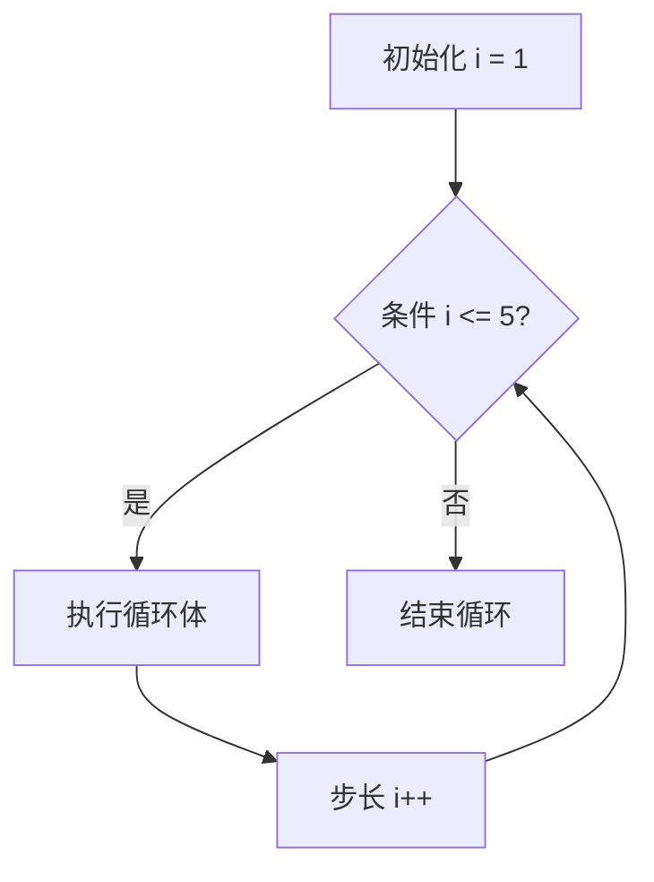

# 06. 循环

在编程中，我们经常需要**重复执行某段代码**。比如：

- 输出 1 到 100 的数字——总不可能写 100 行 `cout` 吧？
- 计算一个班级 30 个学生的平均分。
- 不断询问用户输入，直到用户输入“退出”为止。

这时候，就需要用到**循环结构**。循环可以让程序**重复执行一段代码**，直到满足某个条件才停下来。

::: info 注意
循环结构是程序三大基本结构之一（顺序、分支、循环），它让程序有能力处理大量重复性的工作。
:::

## 1. 三种循环结构

C++ 提供了三种循环语句：

| 循环类型     | 适用场景                     | 特点                         |
| ------------ | ---------------------------- | ---------------------------- |
| `for` 循环   | 知道明确的循环次数           | 结构紧凑，初始化/条件/步长合一 |
| `while` 循环 | 不知道具体次数，只知道条件   | 先判断，后执行               |
| `do-while` 循环 | 至少需要执行一次           | 先执行，后判断               |

## 2. for 循环

**语法：**

```cpp
for (初始化; 条件; 步长) {
    // 循环体
}
```

- **初始化**：定义循环变量并赋初值（如 `int i = 1`），只在循环开始时执行一次。
- **条件**：每次循环开始前判断，为 `true` 就继续执行，为 `false` 就结束循环。
- **步长**：每次循环体执行完后执行，通常用于改变循环变量（如 `i++`）。

**执行流程：**



**示例：输出 1 到 5**

```cpp
#include <iostream>
using namespace std;

int main() {
    for (int i = 1; i <= 5; i++) {
        cout << "第 " << i << " 次循环" << endl;
    }
    return 0;
}
```

输出：
```text
第 1 次循环
第 2 次循环
第 3 次循环
第 4 次循环
第 5 次循环
```

**示例：计算 1 到 100 的和**

```cpp
#include <iostream>
using namespace std;

int main() {
    int sum = 0;

    for (int i = 1; i <= 100; i++) {
        sum += i;  // 等价于 sum = sum + i
    }

    cout << "1 + 2 + ... + 100 = " << sum << endl;
    return 0;
}
```

输出：
```text
1 + 2 + ... + 100 = 5050
```

::: tip 提示
循环变量 `i` 的常见命名习惯：`i`、`j`、`k` 通常用作循环计数器。
如果只需要循环体内的代码，`i` 的值不重要，也可以从 `0` 开始：`for (int i = 0; i < n; i++)`。
:::

**for 循环的变体写法：**

for 循环的三个部分都可以省略，但分号 `;` 不能少。

```cpp
int i = 1;
for (; i <= 5; ) {   // 省略初始化和步长
    cout << i << endl;
    i++;
}
```

::: warning 警告
如果省略条件，就成了**死循环**（无限循环）：`for (;;) { ... }`。程序会一直运行，永不停止。在特定场景（如游戏主循环、服务器监听）会用到，但初学者要避免不小心写出死循环。
:::

## 3. while 循环

**语法：**

```cpp
while (条件) {
    // 循环体
}
```

- **先判断条件**，条件为 `true` 才执行循环体。
- 如果一开始条件就是 `false`，循环体**一次都不执行**。

**示例：用 while 输出 1 到 5**

```cpp
#include <iostream>
using namespace std;

int main() {
    int i = 1;

    while (i <= 5) {
        cout << "第 " << i << " 次循环" << endl;
        i++;  // 别忘了改变循环变量！
    }

    return 0;
}
```

**示例：不断输入数字，直到输入 0 为止**

```cpp
#include <iostream>
using namespace std;

int main() {
    int num;
    cout << "请输入数字（输入 0 结束）：";

    cin >> num;
    while (num != 0) {
        cout << "你输入了：" << num << endl;
        cin >> num;
    }

    cout << "程序结束。" << endl;
    return 0;
}
```

运行示例：
```text
请输入数字（输入 0 结束）：5
你输入了：5
3
你输入了：3
0
程序结束。
```

::: warning 警告
**千万不要忘记在循环体里改变循环变量！** 如果上面的 `i++` 忘了写，`i` 永远都是 1，条件 `i <= 5` 永远为 `true`，程序就会陷入**死循环**，无法结束。
:::

## 4. do-while 循环

**语法：**

```cpp
do {
    // 循环体
} while (条件);
```

- **先执行一次循环体**，再判断条件。
- 无论条件是否成立，**至少执行一次**。

**示例：用 do-while 输出 1 到 5**

```cpp
#include <iostream>
using namespace std;

int main() {
    int i = 1;

    do {
        cout << "第 " << i << " 次循环" << endl;
        i++;
    } while (i <= 5);

    return 0;
}
```

**示例：猜数字游戏（至少问一次）**

```cpp
#include <iostream>
using namespace std;

int main() {
    int secret = 42;
    int guess;

    do {
        cout << "猜猜数字是多少（1-100）：";
        cin >> guess;

        if (guess > secret) {
            cout << "猜大了！" << endl;
        } else if (guess < secret) {
            cout << "猜小了！" << endl;
        } else {
            cout << "恭喜你，猜对了！" << endl;
        }
    } while (guess != secret);

    return 0;
}
```

::: info 注意
`do-while` 和 `while` 的最大区别：
- `while`：先判断，可能一次都不执行。
- `do-while`：先执行一次，再判断，至少执行一次。
:::

## 5. break 和 continue

### 5.1 break —— 立即跳出循环

`break` 用于**立即结束当前循环**，不管循环条件是否还成立。

**示例：找到第一个能被 7 整除的数就停止**

```cpp
#include <iostream>
using namespace std;

int main() {
    for (int i = 1; i <= 100; i++) {
        if (i % 7 == 0) {
            cout << "第一个能被 7 整除的数是：" << i << endl;
            break;  // 找到后就结束循环
        }
    }
    return 0;
}
```

输出：
```text
第一个能被 7 整除的数是：7
```

### 5.2 continue —— 跳过本次循环

`continue` 用于**跳过当前这一次循环**，直接进入下一次循环。

**示例：输出 1 到 10 中所有不是 3 的倍数的数**

```cpp
#include <iostream>
using namespace std;

int main() {
    for (int i = 1; i <= 10; i++) {
        if (i % 3 == 0) {
            continue;  // 跳过 3 的倍数
        }
        cout << i << " ";
    }
    cout << endl;
    return 0;
}
```

输出：
```text
1 2 4 5 7 8 10
```

::: tip 提示
**`break` vs `continue` 的区别：**
- `break`：**结束整个循环**，跑到循环外面去。
- `continue`：**结束本次循环**，回到循环开头进行下一次。
:::

## 6. 嵌套循环

循环里面还可以再套循环，这叫**嵌套循环**。外层循环每执行一次，内层循环会完整地执行一整遍。

**示例：打印九九乘法表**

```cpp
#include <iostream>
using namespace std;

int main() {
    for (int i = 1; i <= 9; i++) {        // 外层循环：行
        for (int j = 1; j <= i; j++) {    // 内层循环：列
            cout << j << "x" << i << "=" << i * j << "\t";
        }
        cout << endl;  // 每行结束后换行
    }
    return 0;
}
```

输出：
```text
1x1=1
1x2=2	2x2=4
1x3=3	2x3=6	3x3=9
1x4=4	2x4=8	3x4=12	4x4=16
1x5=5	2x5=10	3x5=15	4x5=20	5x5=25
...（其余行略）
```

**执行过程分析：**

当 `i = 1` 时，内层循环 `j` 从 1 到 1，输出第 1 行。
当 `i = 2` 时，内层循环 `j` 从 1 到 2，输出第 2 行。
...
当 `i = 9` 时，内层循环 `j` 从 1 到 9，输出第 9 行。

::: tip 提示
嵌套循环的关键：
- **外层循环**控制“大节奏”（比如行数）。
- **内层循环**控制“小节奏”（比如每行输出几个数）。
- 总执行次数 = 外层次数 × 内层次数。
:::

## 7. 三种循环的对比

| 特性         | `for`                | `while`              | `do-while`            |
| ------------ | -------------------- | -------------------- | --------------------- |
| 适用场景     | 已知循环次数         | 未知次数，已知条件   | 至少执行一次          |
| 判断时机     | 先判断               | 先判断               | 先执行，后判断        |
| 最少执行次数 | 0 次                 | 0 次                 | **1 次**              |
| 典型用途     | 遍历数组、固定次数    | 输入直到满足条件     | 菜单选择、猜数字等    |
| 语法特点     | 初始化/条件/步长合一  | 只有条件             | 条件在最后            |

::: tip 提示
初学阶段，建议先熟练掌握 `for` 循环，它结构清晰、使用最广泛。遇到“不知道要循环多少次”的情况时，改用 `while`；遇到“至少要做一次”的情况时，考虑 `do-while`。
:::

## 8. 常见错误

**错误 1：忘记写循环变量的变化 → 死循环**

```cpp
int i = 1;
while (i <= 5) {
    cout << i << endl;
    // 忘了写 i++，i 永远等于 1，循环永远不结束
}
```

**错误 2：条件写反 → 一次都不执行**

```cpp
int i = 1;
while (i > 5) {   // 条件一开始就是 false，循环体一次都不执行
    cout << i << endl;
    i++;
}
```

**错误 3：for 循环多写分号 → 空循环体**

```cpp
int i;
for (i = 1; i <= 5; i++); {   // 分号结束了 for 语句
    cout << i << endl;             // 这行已经在循环外面了
}
```

::: warning 警告
分号 `;` 在 C++ 中表示一条语句结束。`for(...);` 意味着循环体是**空语句**，后面的大括号只是单独的代码块，与循环无关。
:::

## 9. 小结

- **`for` 循环**：适合知道循环次数的场景，结构清晰。
- **`while` 循环**：适合不知道次数、只知道条件的场景。
- **`do-while` 循环**：适合至少需要执行一次的场景。
- **`break`**：立即跳出整个循环。
- **`continue`**：跳过本次循环，进入下一次。
- **嵌套循环**：外层循环控制大节奏，内层循环控制小节奏。
- 注意避免**死循环**和**逻辑错误**。

## 10. 练习

1. **输出数列**：用 `for` 循环输出 1 到 20 之间的所有偶数。

2. **累加求和**：输入一个整数 `n`，用循环计算 1 + 2 + 3 + ... + n 的值。

3. **阶乘计算**：输入一个整数 `n`，计算 `n!`（n 的阶乘，即 1 × 2 × 3 × ... × n）。

4. **统计正负数个数**：输入 10 个整数，统计其中正数和负数的个数（0 不算正数也不算负数）。

5. **猜数字**：用 `do-while` 实现一个猜数字游戏（数字范围 1~100），每次提示“猜大了”或“猜小了”，直到猜对为止。最后输出猜的次数。

6. **打印图形**：用嵌套循环输出以下图案：
   ```text
   *
   **
   ***
   ****
   *****
   ```

7. **水仙花数**：找出所有三位数中的水仙花数。
   > 水仙花数是指一个三位数，其各位数字的立方和等于该数本身。例如：153 = 1³ + 5³ + 3³。

8. **挑战题：百钱百鸡**：公鸡 5 元一只，母鸡 3 元一只，小鸡 1 元三只。用 100 元买 100 只鸡，问公鸡、母鸡、小鸡各多少只？（提示：用嵌套循环枚举所有可能）
