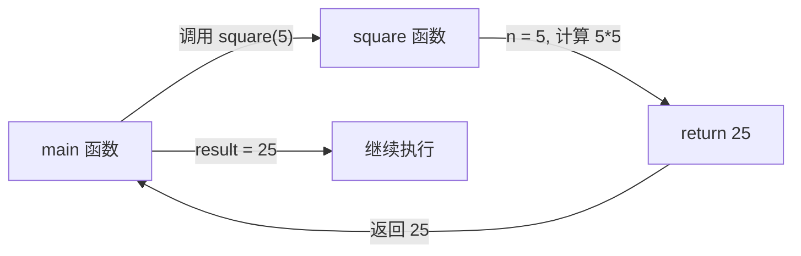

# 07. 函数

## 1. 为什么需要函数？

假设你要写一个程序，多次计算两个数的最大值。你会怎么做？

**不优雅的做法：** 每次需要比较时都重新写一遍比较逻辑：

```cpp
int a = 10, b = 20;
int max1;
if (a > b) max1 = a; else max1 = b;

int c = 15, d = 8;
int max2;
if (c > d) max2 = c; else max2 = d;
// ... 每次都要重复写这段逻辑
```

**优雅的做法：** 把“比较两个数大小”的逻辑**封装成一个函数**，需要用的时候直接“调用”就行了：

```cpp
int max(int x, int y) {
    if (x > y) return x;
    else return y;
}

// 然后直接调用
int max1 = max(10, 20);   // 得到 20
int max2 = max(15, 8);    // 得到 15
```

::: info 注意
**函数**就是一段**可重复使用的代码块**，它接收输入（参数），执行特定的操作，然后返回结果（返回值）。

使用函数的好处：
- **避免重复代码**：写一次，反复用。
- **提高可读性**：`max(a, b)` 比一长串 `if-else` 更容易理解。
- **便于维护**：要修改比较逻辑，只需要改函数内部，所有调用处自动生效。
- **模块化**：把大问题拆成小函数，逐个解决。
:::

## 2. 函数的定义和调用

### 2.1 定义函数

**语法：**

```cpp
返回值类型 函数名(参数列表) {
    // 函数体
    return 返回值;
}
```

各部分说明：

| 组成部分     | 说明                                       | 示例                         |
| ------------ | ------------------------------------------ | ---------------------------- |
| 返回值类型   | 函数返回的数据类型。如果不返回任何值，用 `void` | `int`、`double`、`void`      |
| 函数名       | 用来标识函数的名字，命名规则同变量           | `max`、`sayHello`、`getSum`  |
| 参数列表     | 函数接收的输入，多个参数用逗号分隔           | `int x, int y`               |
| 函数体       | 函数内部执行的代码                           | `{ return x + y; }`          |
| `return`     | 返回结果给调用者，`void` 函数可以省略         | `return sum;`                |

**示例：定义一个求平方的函数**

```cpp
int square(int n) {
    return n * n;
}
```

这个函数：
- 返回值类型是 `int`（返回整数）
- 函数名是 `square`
- 参数是 `int n`（接收一个整数）
- 返回 `n * n`（计算结果）

### 2.2 调用函数

定义好函数以后，在 `main()` 或其他地方通过**函数名 + 括号 + 参数**来使用它：

```cpp
#include <iostream>
using namespace std;

// 定义函数
int square(int n) {
    return n * n;
}

int main() {
    int a = 5;
    int result = square(a);  // 调用函数，把 a 的值传给 n
    cout << a << " 的平方是：" << result << endl;

    cout << "10 的平方是：" << square(10) << endl;  // 也可以直接用在 cout 里

    return 0;
}
```

输出：
```text
5 的平方是：25
10 的平方是：100
```

**调用过程：**



::: tip 提示
调用函数时，传入的值（如 `a`、`10`）叫做**实参**（实际参数）。
函数定义中的变量（如 `n`）叫做**形参**（形式参数）。
实参会把值**复制**一份给形参，函数内部修改形参不影响实参。
:::

## 3. 函数的参数

### 3.1 无参数函数

有些函数不需要接收任何输入：

```cpp
#include <iostream>
using namespace std;

void sayHello() {
    cout << "你好，欢迎学习C++！" << endl;
}

int main() {
    sayHello();  // 调用，不需要传参数
    sayHello();  // 可以反复调用
    return 0;
}
```

### 3.2 多个参数的函数

```cpp
#include <iostream>
using namespace std;

int add(int a, int b) {
    return a + b;
}

int main() {
    int sum = add(3, 5);
    cout << "3 + 5 = " << sum << endl;     // 输出 8
    cout << add(100, 200) << endl;          // 输出 300
    return 0;
}
```

### 3.3 无返回值函数（void）

如果函数不需要返回结果，用 `void` 作为返回值类型：

```cpp
#include <iostream>
#include <string>
using namespace std;

void printInfo(string name, int age) {
    cout << "姓名：" << name << endl;
    cout << "年龄：" << age << endl;
    // 没有 return 语句
}

int main() {
    printInfo("小明", 12);
    return 0;
}
```

输出：
```text
姓名：小明
年龄：12
```

::: info 注意
`void` 函数也可以写 `return;` 来提前结束函数，但不返回任何值：
```cpp
void check(int score) {
    if (score < 0) {
        cout << "分数不能为负数！" << endl;
        return;  // 提前结束
    }
    cout << "分数是：" << score << endl;
}
```
:::

## 4. 函数应该放在哪里？

在 C++ 中，函数**必须先声明或定义，然后才能调用**。

### 4.1 把函数定义写在 main 之前（推荐新手）

```cpp
#include <iostream>
using namespace std;

// 函数定义放在 main 之前
int add(int a, int b) {
    return a + b;
}

int main() {
    cout << add(3, 5) << endl;  // 没问题，编译器已经知道 add 了
    return 0;
}
```

### 4.2 函数声明（前向声明）

如果想把函数定义放在 `main` 后面，需要先在前面**声明**函数：

```cpp
#include <iostream>
using namespace std;

// 函数声明（也叫"函数原型"）：告诉编译器有这么一个函数
int add(int a, int b);

int main() {
    cout << add(3, 5) << endl;  // 没问题，编译器知道 add 存在
    return 0;
}

// 函数定义放在 main 后面
int add(int a, int b) {
    return a + b;
}
```

::: tip 提示
函数声明可以省略参数名，只写类型：`int add(int, int);`
但带上参数名可以让代码更清晰，建议保留。
:::

## 5. 变量的作用域

### 5.1 局部变量

在**函数内部**定义的变量叫做局部变量，只能在当前函数内使用：

```cpp
void funcA() {
    int x = 10;   // x 只在 funcA 中有效
    cout << x << endl;
}

void funcB() {
    // cout << x << endl;  // 错误！x 在 funcB 中不可见
    int x = 20;   // 这是 funcB 自己的 x，和 funcA 的 x 无关
    cout << x << endl;
}
```

### 5.2 全局变量

在**所有函数之外**定义的变量叫做全局变量，整个程序都可以访问：

```cpp
#include <iostream>
using namespace std;

int globalCount = 0;  // 全局变量

void addOne() {
    globalCount++;  // 函数内部可以访问和修改全局变量
}

int main() {
    cout << globalCount << endl;  // 0
    addOne();
    cout << globalCount << endl;  // 1
    addOne();
    cout << globalCount << endl;  // 2
    return 0;
}
```

::: warning 警告
全局变量虽然方便，但**不建议滥用**。因为任何函数都可以修改它，程序大了以后很难追踪是谁修改了它的值。优先使用局部变量和函数参数传递数据。
:::

## 6. 完整示例程序

**题目：编写一个程序，包含多个函数，计算圆的面积和周长。**

```cpp
#include <iostream>
using namespace std;

const double PI = 3.14159;

// 计算圆的面积
double calcArea(double radius) {
    return PI * radius * radius;
}

// 计算圆的周长
double calcPerimeter(double radius) {
    return 2 * PI * radius;
}

// 输出圆的详细信息
void printCircleInfo(double radius) {
    cout << "半径：" << radius << endl;
    cout << "面积：" << calcArea(radius) << endl;
    cout << "周长：" << calcPerimeter(radius) << endl;
}

int main() {
    double r;
    cout << "请输入圆的半径：";
    cin >> r;

    printCircleInfo(r);

    return 0;
}
```

运行示例：
```text
请输入圆的半径：5
半径：5
面积：78.5397
周长：31.4159
```

## 7. 小结

- **函数**是把一段代码封装起来，方便重复使用的工具。
- 定义函数需要指定：**返回值类型**、**函数名**、**参数列表**、**函数体**。
- 用 `return` 返回结果，`void` 函数可以不返回。
- 函数必须先声明/定义才能调用。
- **局部变量**在函数内部有效，**全局变量**在整个程序有效。
- 把大问题拆成小函数，可以让程序更清晰、更容易维护。

## 8. 练习

1. **简单函数**：编写一个函数 `int triple(int n)`，返回输入数字的 3 倍。在 `main` 中调用并输出结果。

2. **判断奇偶**：编写一个函数 `bool isEven(int n)`，判断整数是否为偶数。如果是偶数返回 `true`，否则返回 `false`。在 `main` 中测试。

3. **最大值**：编写一个函数 `int maxOfThree(int a, int b, int c)`，返回三个数中的最大值。

4. **温度转换**：编写两个函数：
   - `double celsiusToFahrenheit(double c)`：摄氏度转华氏度（公式：F = C × 9/5 + 32）
   - `double fahrenheitToCelsius(double f)`：华氏度转摄氏度（公式：C = (F - 32) × 5/9）
   在 `main` 中测试两种转换。

5. **判断素数**：编写一个函数 `bool isPrime(int n)`，判断一个整数是否为素数（质数）。
   > 素数是指大于 1，且只能被 1 和自身整除的自然数。

6. **最大公约数**：编写一个函数 `int gcd(int a, int b)`，用辗转相除法求两个数的最大公约数。
   > 辗转相除法：`gcd(a, b) = gcd(b, a % b)`，直到余数为 0。

7. **挑战题：万年历**：编写一个函数 `bool isLeapYear(int year)` 判断闰年，一个函数 `int getDaysInMonth(int year, int month)` 返回某个月的天数，然后在 `main` 中输入年份和月份，输出该月有多少天。
