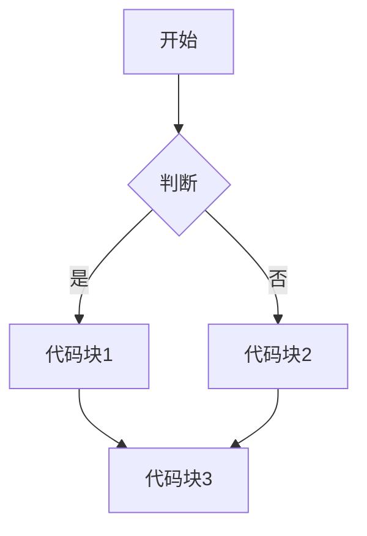
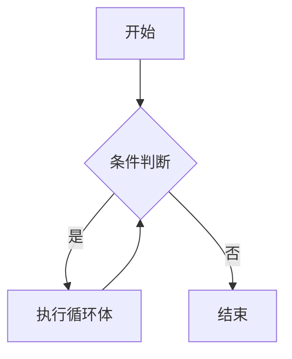

# 🔁 分支与循环结构

## 一、流程结构
在程序执行过程中，有三种基本结构：

- **顺序结构**：一条一条语句按顺序执行。
- **分支结构**：根据条件判断，决定执行哪部分代码。
- **循环结构**：满足条件时，反复执行某段代码。

之前接触的程序都是顺序结构，接下来开始学习两种常见的结构：分支和循环。

> 💬: 为什么需要分支和循环结构？


## 二、bool 类型、运算符与缩进
### 1. 布尔值（bool 类型）
- Python 中的布尔值（`bool`）只有两个：`True`（真）和 `False`（假）。比如：`5 > 3` 返回 `True`，`2 == 3` 返回 `False`。
- 条件判断时，结果都是布尔值。
### 2.  逻辑运算符

- `and`：与，两个条件都为 True，结果才为 True。 
- `or`：或，至少一个条件为 True，结果为 True。
- `not`：非，True 变 False，False 变 True。

```python
x = 5
y = 10
print(x > 0 and y > 0)  # True
print(x > 0 or y < 0)   # True
print(not(x > 0))       # False
```
### 3.  比较运算符

| 运算符 | 含义     |
| ------ | -------- |
| >      | 大于     |
| >=     | 大于等于 |
| <      | 小于     |
| <=     | 小于等于 |
| ==     | 等于     |
| !=     | 不等于   |

### 4. `in` 成员操作符

- 判断某个元素是否存在于序列（字符串、列表、元组、集合、字典的键）中，返回布尔值 `True` 或 `False`。

```python
s = "hello"
print('h' in s)        # True
print('a' in s)        # False
print ('l' not in s)   # True
```
### 5. 缩进与代码块

- Python 使用**缩进**表示代码块，通常为 **4 个空格** 或 **1 个 Tab**。
- 缩进相同的语句属于同一代码块。
- 和其他语言用大括号不同，Python **必须正确缩进**。
- 缩进不一致会导致程序错误，或逻辑混乱。
```python
if x > 0:
    print("正数")
    print("这是 if 里面的代码块")
print("这是外面的代码")
```

## 三、分支结构（判断）

### 1. if 单分支结构
#### 语法：
```python
if 条件:
    代码块
```
#### 示例：
```python
score = 75
if score >= 60:
    print("及格了！")
```
##### 输出：
```
及格了！
```
### 2. if-else 双分支结构
#### 语法：
```python
if 条件:
    代码块1
else:
    代码块2
```
#### 示例：
```python
num = int(input("请输入一个整数："))
if num % 2 == 0:
    print("偶数")
else:
    print("奇数")
```
### 3. if-elif-else 多分支结构
#### 语法：
```python
if 条件1:
    代码块1
elif 条件2:
    代码块2
else:
    代码块3
```
#### 示例：
```python
score = int(input("请输入成绩："))
if score >= 90:
    print("优秀")
elif score >= 60:
    print("及格")
else:
    print("不及格")
```
> 对 `if`语句，有且只有一个`if`,`else`可以没有，也可以有一个，`elif`则可以多个，根据具体情况而定。

### 4. 嵌套 if 结构
 嵌套 if 结构指的是在 if 程序块里面使用 if 程序。

#### 语法：

```python
if 条件1:
    if 条件2:
        代码块1
    else:
        代码块2
else:
    代码块3
```
#### 示例：
```python
age = int(input("请输入年龄："))
if age >= 18:
    gender = input("请输入性别（男/女）：")
    if gender == "男":
        print("成年男性")
    else:
        print("成年女性")
else:
    print("未成年人")
```
### 5. 基础比较、复合比较和链式比较
#### 基础比较
基础比较是最简单的比较程序，两个值之间直接比较
```python
a > b  
a == b  
a != b  
a >= 3
a !=100
```
#### 复合比较
复合比较是通过逻辑运算符连接多个比较，综合判断最后的结果：
```python
a > 0 and b > 0
a > 0 or b > 0
a > 0 and b < 0 or c ==0
```
#### 链式比较
```python
0 < a < 100 # 等价于 0 < a and a < 100
60 <= a <= 90 # 等价于 a >= 60 and a <= 90
```
这种比较方式可能更为简洁
## 三、循环结构

### 1. while 循环
#### 语法：
```python
while 条件:
    代码块
```
#### 示例：
```python
count = 1
while count <= 5:
    print("第", count, "次循环")
    count += 1
```
#### 输出：
```
第 1 次循环
第 2 次循环
第 3 次循环
第 4 次循环
第 5 次循环
```
#### 注意：
- while 循环里的条件也必须是 bool 类型。
- 如果条件一直为 True，循环不会停止（熟称死循环）。
### 2. for 循环
#### 语法：
```python
for 变量 in 序列:
    代码块
```
#### 示例：
```python
for i in range(1, 6):
    print(i)
```
#### 输出：
```
1
2
3
4
5
```
> `range(10)` 生成的是数字序列：0, 1, 2, ..., 9，共10个数字。
>
> `for i in range(10)` 意思是：变量 `i` 依次取这10个数字,每取一个数字，执行一次循环体（循环里面的代码）。
>
> 所以，循环体会“重复执行10次”。
#### range() 函数说明：
- `range(5)` → 0, 1, 2, 3, 4
- `range(起点, 终点)` → 从起点到终点-1
- `range(起点, 终点, 步长)`
> 有时候我们只需要循环的次数，并不需要用到变量`i`，可以直接省略`i`，强调这个循环只需要次数：
>
> ```python
> for _ in range(10):
>    	print("你好")
> ```
>
> 这段程序将输出 10 次“你好”。

### 3. 嵌套 for 循环
#### 语法：
```python
for 变量1 in 序列1:
    for 变量2 in 序列2:
        代码块
```
#### 示例：九九乘法表
```python
for i in range(1, 10):
    for j in range(1, i + 1):
        print(f"{j}*{i}={i*j}", end="\t")
    print()
```
#### 输出：
```
1*1=1
1*2=2	2*2=4
1*3=3	2*3=6	3*3=9
...
```
### 4. break 和 continue
#### break：提前结束循环
```python
while True:
    num = int(input("请输入一个正数："))
    if num > 0:
        print("输入正确！")
        break
    else:
        print("请重新输入！")
```
#### continue：跳过本次循环
```python
for i in range(1, 6):
    if i == 3:
        continue
    print(i)
```
#### 输出：
```
1
2
4
5
```
### 5. for-else 结构
- `for` 循环正常结束后，会执行 `else` 中的代码。
- 如果循环被 `break` 中断，则不会执行 `else`。
#### 示例：
```python
for i in range(1, 5):
    print(i)
else:
    print("循环正常结束，没有被break中断")
```
输出：

```python
1
2
3
4
循环正常结束，没有被break中断
```
#### 带 break 的示例：
```python
for i in range(1, 5):
    if i == 3:
        break
    print(i)
else:
    print("不会执行，因为循环被break中断了")
```
输出：
```python
1
2
```
## 四、小结
- **顺序结构、分支结构、循环结构** 是程序的三大基本结构。
- Python 使用缩进表示代码块，注意保持缩进一致。
- 条件判断中的比较运算符：`> >= < <= == !=`
- 逻辑运算符：`and`、`or`、`not`
- `while` 和 `for` 循环根据条件反复执行，`break` 和 `continue` 控制循环流程。
- `while`和`for`可以实现的功能相同，但是`while`用来一般用来实现不确定次数的循环，`for`这确定次数确定的循环
- 嵌套 if、嵌套 for 是多层判断和多层循环的重要写法。
## 五、练习题
1. 输入一个整数，判断是否大于 0，如果大于0，打印：大于0。
2. 输入一个整数，判断是正数、负数或零。
3. 输入两个整数，判断它们是否相等。
4. 输入一个年龄，判断是否成年。
5. 输入一个成绩，判断是否及格，及格输出“通过”，否则“未通过”。
6. 输入一个字符，判断是否是大写字母。
7. 输入三个整数，输出其中最大的一个。
8. 输入用户名和密码，判断是否同时符合“admin” 和“123456”。逻辑运算符 
9. 输入两个数字，判断是否至少有一个大于 50。逻辑运算符 
10. 输入一个年份，判断是否为闰年。>
    > 闰年规则：年份能被4整除且不能被100整除，或者能被400整除。
11. 输入三角形三边，判断是否能构成三角形。
    > 三角形的判定：任意2条边都大于第三边
12. 使用 <kbd>while</kbd> 循环，输出 1 到 5。
13. 输入一个正整数 n，计算 1 到 n 的和。
14. 使用 <kbd>for</kbd> 循环，输出 1 到 10 的奇数。
15. 使用 <kbd>for</kbd> 循环，输出九九乘法表。嵌套 
16. 输入一个正整数，判断是否为质数。
17. 输入一个整数，使用 <kbd>while</kbd> 判断直到输入为正数才结束。
18. 输入一个正整数，输出它的所有因子。
19. 使用嵌套循环打印一个 5 行的星号三角形。
20. 猜数字游戏：程序预先确定一个数字，用户最多输入 10 次，超过次数提示失败。