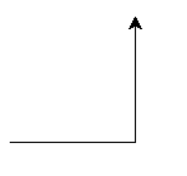

# 🐢 海龟画图

## 一、什么是海龟画图？

海龟画图（Turtle Graphics）是 Python 中一个非常有趣的绘图模块，它让我们通过控制一只“海龟”在屏幕上移动，从而画出各种图案。

- **入门简单**：只需要几行代码就能画图。
- **形象直观**：程序员能马上看到程序的“画画”结果。
- **容易拓展**：从画正方形，到画多边形、花朵、甚至简单游戏，都能实现。
- **结果有趣**：可以画图形、图案、写文字，还能创作小游戏等。

## 二、Turtle 是怎么工作的？

我们可以想象有一只“自动铅笔”在画布上：

- 它可以**向前走**、**转弯**、**抬笔/落笔**；
- 每次走动，都会在屏幕上留下线条；
- 控制它的“路线”，就能画出各种图形。

这只铅笔就是我们的 **“海龟”**。

## 三、如何使用海龟？

先导入模块，再使用命令控制海龟。例如：

```python
import turtle           # 导入模块

t = turtle.Turtle()     # 创建海龟

t.forward(100)          # 向前 100 像素
t.left(90)              # 左转 90°
t.forward(100)          # 向前 100 像素

turtle.done()           # 绘制完成(每次绘制完成都需要写下这句话告知计算机)
```

运行这段代码后，海龟会画出一个简单的“L”形：



## 四、常见用途

| 用途     | 说明                             |
| -------- | -------------------------------- |
| 画图形   | 正方形、三角形、五角星、圆等     |
| 写字     | 在画布上写“Hello”、“Python”等    |
| 设计图案 | 用颜色、角度、循环组合出美丽图形 |
| 小小游戏 | 比如点击事件、迷宫、找宝藏等     |

## 五、为什么要学它？

学习海龟画图最大的价值，是能把代码的运行结果直接呈现在画布上。每一条指令都会让图形发生变化，这让“顺序、方向、距离”这些编程中的抽象概念变得清晰可见，更容易理解代码究竟在做什么。

同时，海龟画图也自然地引出后续要学的循环、函数、变量等内容，让入门过程更平稳。图形画得不对时，很直观就能发现问题，调整思路也更轻松，是开始学习 Python 时很合适的起点。

##　六、海龟画图常用 API 总览

> 在 Python 里，**API 函数就是程序提供给你调用的“功能接口”**，你只需要按要求传入参数，就能让程序帮你完成某件事情，而不必自己去写全部实现过程。海龟画图里的 `forward()`、`right()` 就是 API 函数：你调用它，海龟就会移动或者转向，而不需要知道海龟内部是如何计算坐标、画线的。

### 1. 运动控制

| 函数/方法                      | 示例               | 作用说明                    |
| ------------------------------ | ------------------ | --------------------------- |
| `forward(distance)` / `fd()`   | `t.forward(100)`   | 向前移动指定距离            |
| `backward(distance)` / `bk()`  | `t.backward(50)`   | 向后移动指定距离            |
| `right(angle)` / `rt()`        | `t.right(90)`      | 向右转动角度（顺时针）      |
| `left(angle)` / `lt()`         | `t.left(90)`       | 向左转动角度（逆时针）      |
| `setheading(angle)` / `seth()` | `t.setheading(0)`  | 设置朝向（0为右，90为上）   |
| `goto(x, y)`                   | `t.goto(100, 200)` | 移动到指定坐标              |
| `setx(x)` / `sety(y)`          | `t.setx(50)`       | 设置横/纵坐标               |
| `home()`                       | `t.home()`         | 回到原点，方向朝右          |
| `speed()`                      | `t.speed(0)`       | 移动速度（1~10）(取0则最快) |

### 2. 画笔控制

| 函数/方法            | 示例                    | 作用说明                      |
| -------------------- | ----------------------- | ----------------------------- |
| `pendown()` / `pd()` | `t.pendown()`           | 放下画笔，开始绘图            |
| `penup()` / `pu()`   | `t.penup()`             | 抬起画笔，移动时不画线        |
| `pensize(width)`     | `t.pensize(5)`          | 设置画笔粗细                  |
| `pencolor(color)`    | `t.pencolor("red")`     | 设置画笔颜色（可用英文或RGB） |
| `fillcolor(color)`   | `t.fillcolor("yellow")` | 设置填充颜色                  |
| `begin_fill()`       | `t.begin_fill()`        | 开始填充图形                  |
| `end_fill()`         | `t.end_fill()`          | 结束填充图形                  |
| `speed(speed)`       | `t.speed(3)`            | 设置画图速度（0最快，1-10）   |

### 3. 形状与图形绘制

| 函数/方法                | 示例                 | 作用说明                                       |
| ------------------------ | -------------------- | ---------------------------------------------- |
| `circle(radius)`         | `t.circle(50)`       | 画圆（单位为半径，半径为正顺时针，负为逆时针） |
| `circle(radius, extent)` | `t.circle(100, 180)` | 画部分圆（弧形）                               |
| `dot(size, color)`       | `t.dot(20, "blue")`  | 画一个圆点（单位为直径）                       |
| `stamp()`                | `t.stamp()`          | 在当前位置盖章                                 |
| `clearstamp(stampid)`    | ——                   | 清除指定 stamp                                 |
| `clearstamps()`          | `t.clearstamps()`    | 清除所有盖章                                   |

### 4. 海龟外观控制

| 函数/方法               | 示例                | 作用说明                             |
| ----------------------- | ------------------- | ------------------------------------ |
| `shape("形状")`         | `t.shape("turtle")` | 设置海龟形状（如 "turtle", "arrow"） |
| `shapesize(w, h)`       | `t.shapesize(2, 2)` | 设置形状大小（宽高倍数）             |
| `showturtle()` / `st()` | `t.showturtle()`    | 显示海龟                             |
| `hideturtle()` / `ht()` | `t.hideturtle()`    | 隐藏海龟                             |

### 5. 角度与坐标

| 函数/方法              | 示例                  | 作用说明                   |
| ---------------------- | --------------------- | -------------------------- |
| `heading()`            | `angle = t.heading()` | 返回当前朝向角度           |
| `position()` / `pos()` | `x, y = t.position()` | 返回当前位置坐标           |
| `xcor()` / `ycor()`    | `x = t.xcor()`        | 获取当前横坐标 / 纵坐标    |
| `distance(x, y)`       | `t.distance(0, 0)`    | 计算当前位置到指定点的距离 |
| `towards(x, y)`        | `t.towards(100, 100)` | 返回朝向指定点的角度       |

### 6. 画布控制与颜色设置

| 函数/方法          | 示例                           | 作用说明                         |
| ------------------ | ------------------------------ | -------------------------------- |
| `bgcolor(color)`   | `t.screen.bgcolor("skyblue")`  | 设置背景颜色                     |
| `screensize(w, h)` | `t.screen.screensize(800,600)` | 设置画布大小   |
|`setup(width, height, startx, starty)`|`turtle.setup(800, 600, 100, 100)`|设置窗口大小和位置（像素级窗口尺寸和屏幕位置）|
| `reset()`          | `t.reset()`                    | 清空画布并重置海龟               |
| `clear()`          | `t.clear()`                    | 清空画布（不改变海龟位置和方向） |

### 7. 状态判断与辅助函数

| 函数/方法          | 示例                                             | 作用说明         |
| ------------------ | ------------------------------------------------ | ---------------- |
| `isdown()`         | `t.isdown()`                                     | 判断画笔是否放下 |
| `write(text, ...)` | `t.write("Hello", font=("Arial", 16, "normal"))` | 在当前位置写字   |

## 七、海龟画图的思路

### 1. 相对移动

海龟画图默认使用的是**相对移动**：每一步的方向和位置都基于海龟当前的状态。

- 指令示例：

```python
t.forward(100)  # 向前走100步
t.right(90)     # 向右转90度
```

- 思路：
  1. 先确定当前方向
  2. 走多远
  3. 转多少度
  4. 重复操作，直到画出完整图形

> 优点：自然、顺手、容易用循环画多边形
> 缺点：海龟起点和方向不同，画出来的图形位置可能会变，需要思考相对位置。

### 2. 绝对坐标

海龟也可以直接移动到画布上指定的坐标点，这种方法叫**绝对坐标定位**。

- 指令示例：

```python
t.goto(0, 0)     # 移动到坐标原点
t.goto(100, 0)   # 移动到 x=100, y=0
```

- 思路：
  1. 先确定每个顶点的坐标
  2. 按顺序让海龟跳到每个顶点
  3. 画出图形

> 优点：位置精确，不怕起点方向不同
>  缺点：需要计算坐标

> [!Note]
> 在实际的绘图过程中，我们也可以同时使用相对移动和绝对坐标的办法

## 八、示例

### 1. 绘制简单的几何图形

#### 绘制一个正方形

```python
import turtle as t


pen = t.Turtle()      # 创建海龟对象
pen.pensize(3)        # 设置画笔宽度
pen.pencolor("red")   # 设置画笔颜色


for i in range(4):
    pen.forward(100)
    pen.right(90)


t.done()              # 保持画布窗口
```

#### 绘制一个等边三角形

```python
import turtle
t = turtle.Turtle()
# 画一个边长为100的等边三角形
for i in range(3):
    t.forward(100)
    t.left(120)
turtle.done()
```

#### 绘制一个圆形

```python
import turtle
t = turtle.Turtle()
t.circle(50)
turtle.done()
```

#### 绘制一个黄色的圆

```python
import turtle as t
pen = t.Turtle()
pen.pensize(3)             # 画笔宽度
pen.pencolor("blue")       # 边框颜色
pen.fillcolor("yellow")    # 填充颜色
pen.begin_fill()           # 开始填充
pen.circle(100)            # 画半径为100的圆
pen.end_fill()             # 结束填充，自动封闭路径并填充颜色
t.done()
```

#### 绘制一个圆环-方法1

```python
import turtle as t

pen = t.Turtle()
pen.pensize(3)
pen.pencolor("blue")
pen.fillcolor("yellow")

# 画大圆，填充黄色
pen.penup()
pen.goto(0, -100)    # 大圆起点，圆心在 (0,0)，半径100
pen.pendown()
pen.begin_fill()
pen.circle(100)
pen.end_fill()

# 画小圆，填充背景色，圆心与大圆一致
pen.penup()
pen.goto(0, -60)     # 小圆起点，半径60
pen.pendown()
pen.fillcolor("white")
pen.begin_fill()
pen.circle(60)
pen.end_fill()

pen.hideturtle()
t.done()
```

#### 绘制一个圆环-方法2

```python
import turtle as t

pen = t.Turtle()
pen.pensize(30)         # 粗线条画圆
pen.pencolor("red")
pen.circle(100)
t.hideturtle()
t.done()
```

### 2. 绘制组合图形

#### 房子形状（正方形 + 三角形屋顶）

```python
import turtle
t = turtle.Turtle()
# 画正方形（房子主体）
for _ in range(4):
    t.forward(100)
    t.right(90)
# 画三角形（屋顶）
t.left(90)
t.forward(100)
t.right(45)
t.forward(70)
t.right(90)
t.forward(70)
turtle.done()
```

#### 五角星＋正方形（中心叠加）

```python
import turtle
t = turtle.Turtle()
# 画五角星
for _ in range(5):
    t.forward(100)
    t.right(144)
# 移动画正方形，确保中心对齐
t.penup()
t.goto(-50, -50)
t.pendown()
for _ in range(4):
    t.forward(100)
    t.right(90)
turtle.done()
```

#### 三个不同大小的同心圆（层叠效果）

```python
import turtle
t = turtle.Turtle()
radii = [50, 100, 150]
for r in radii:
    t.penup()
    t.goto(0, -r)  # 定位到圆底部起点
    t.pendown()
    t.circle(r)
turtle.done()
```

#### 太阳和光线（圆 + 多条线）

```python
import turtle
t = turtle.Turtle()
t.pencolor("red")
# 光线
for _ in range(12):
    t.penup()
    t.goto(0, 0)
    t.pendown()
    t.forward(70)
    t.backward(70)
    t.right(30)
# 太阳主体
t.penup()
t.goto(0, -50)
t.pendown()
t.fillcolor("yellow")
t.begin_fill()
t.circle(50)
t.end_fill()
turtle.done()
```
