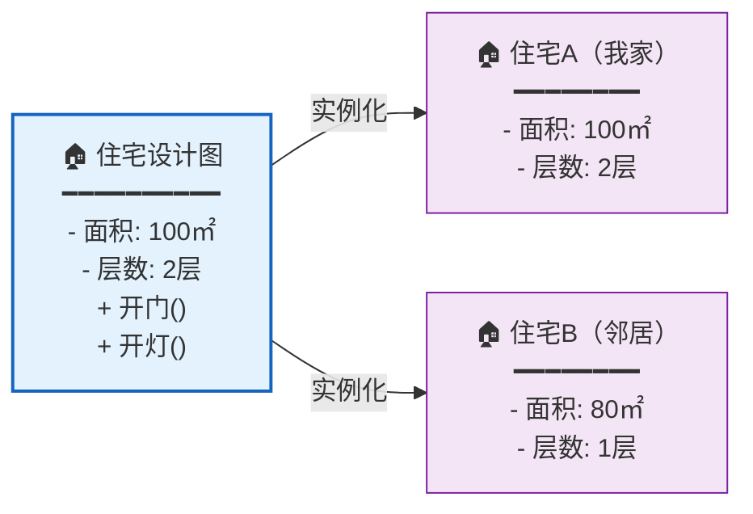

# 02. 类和对象

> 经过 `string` 的学习，实际上已经接触过类和对象的概念——`string` 本身就是一个类。

## 1. 为什么需要类？

回顾此前学习的数据类型：

| 类型       | 存储内容 | 支持的操作                          |
| ---------- | -------- | ----------------------------------- |
| `int`    | 整数     | 算术运算                            |
| `double` | 浮点数   | 算术运算                            |
| `char[]` | 字符串   | 需借助 `strlen`、`strcpy` 等函数 |

以上类型存在一个共同缺陷：**数据与其操作函数是分离的**。

以描述“学生”为例：

```cpp
string name = "小明";
int age = 10;
int score = 95;

// 需自行编写打印函数：
void printStudent(string name, int age, int score) {
    cout << name << " " << age << "岁 " << score << "分" << endl;
}
```

当学生数量增多时，数据散落在各个独立变量中，管理和维护将变得困难。

**类（class）** 正是为了解决这一问题而设计的——**将数据及其操作封装为一个整体**。

## 2. 类与对象的基本概念

可以将类与对象的关系理解为**模板与实例**的关系：

> **类（class）** ：定义了数据结构和行为的抽象模板
> **对象（object）** ：根据类模板创建的具体实例

例如：



同一份类模板可以创建多个不同的对象实例——**一个类可以实例化出多个对象**。

## 3. 类的定义

```cpp
class Student {             // 关键字 class 后跟类名
public:                     // 访问说明符：公开成员
    // ── 成员变量（属性） ──
    string name;
    int age;
    int score;

    // ── 成员函数（方法） ──
    void print() {
        cout << name << " " << age << "岁 " << score << "分" << endl;
    }
};                          // 类定义结束后须加分号
```

### 3.1 访问说明符：public / private

类成员有访问权限控制，用 `public:` 和 `private:` 来划分区域：

| 访问说明符   | 含义                   | 能否在类外部访问 |
| ------------ | ---------------------- | ---------------- |
| `public:`  | 公开，任何地方都能访问 | ✅ 可以          |
| `private:` | 私有，只有类内部能访问 | ❌ 不可以        |

```cpp
class Test {
private:              // 下面的成员都是私有的
    int secret;       // 外部不能直接访问

public:               // 下面的成员都是公开的
    int visible;      // 外部可以直接访问
    void show() { cout << secret; }   // ✅ 类内部可以访问 private
};
```

::: warning 警告
**`class` 默认是 `private`**——如果不写任何访问说明符，所有成员默认私有：

```cpp
class Test {
    int x;          // 默认 private，类外部不能用
};
```

而 `struct` 默认是 `public`。**这是 `class` 和 `struct` 最主要的区别**（继承时的默认权限也不同，见 8.2 继承）。
:::

### 3.2 访问说明符可以交替使用

同一个类中可以多次切换 `public:` 和 `private:`，按需划分区域：

```cpp
class Student {
private:                  // 私有：不想让外部直接改的数据
    int secret_id;

public:                   // 公开：外部可以调用的接口
    string name;
    int age;

private:                  // 又切回私有
    int internal_code;

public:                   // 又切回公开
    void print() { /* ... */ }
};
```

通常的做法是：**成员变量放 `private`，成员函数放 `public`**。不过初学阶段先把所有成员放 `public` 也没问题，后续学到封装再深入 `private` 的用法。

## 4. 对象的创建

```cpp
// 接上文：Student 类的定义见上一节
int main() {
    Student s1;             // 创建对象，语法与声明变量类似
    s1.name = "小明";       // 为成员变量赋值
    s1.age = 10;
    s1.score = 95;
    s1.print();             // 调用成员函数 → "小明 10岁 95分"

    Student s2;             // 创建第二个对象
    s2.name = "小红";
    s2.age = 11;
    s2.score = 100;
    s2.print();             // → "小红 11岁 100分"

    return 0;
}
```

由此可见，**数据与操作数据的函数被封装在一起**，每个对象独立管理自身数据，结构清晰。

## 5. 构造函数

每次创建对象后逐一手动赋值较为繁琐。C++ 提供了**构造函数（constructor）** 机制，使对象在创建时即可自动完成初始化：

```cpp
#include <iostream>
#include <string>
using namespace std;

class Student {
public:
    string name;
    int age;
    int score;

    // 构造函数：名称与类名相同，无返回值类型
    Student(string n, int a, int s) {
        name = n;
        age = a;
        score = s;
    }

    void print() {
        cout << name << " " << age << "岁 " << score << "分" << endl;
    }
};

int main() {
    Student s1("小明", 10, 95);   // 创建时直接传入参数
    Student s2("小红", 11, 100);
    s1.print();
    s2.print();
    return 0;
}
```

构造函数在对象创建时**自动调用**，确保每个对象初始化完毕即可使用。

### 5.1 默认构造函数

若未定义任何构造函数，C++ 会隐式提供一个**默认构造函数**：类类型成员（如 `string`）会被默认构造（得到空字符串），基本类型成员（如 `int`）则不初始化：

```cpp
class Student {
public:
    string name;
    int age;
};

Student s;   // 可通过默认构造函数创建：name 是空字符串，age 未初始化
```

然而，一旦**用户自定义了任一构造函数**，默认构造函数不再自动生成。若仍需支持无参构造，须显式定义：

```cpp
class Student {
public:
    Student() {}                   // 显式定义无参构造函数
    Student(string n, int a) {     // 有参构造函数
        name = n;
        age = a;
    }
    string name;
    int age;
};

Student s1;              // 使用无参构造函数
Student s2("小明", 10);  // 使用有参构造函数
```

## 6. 静态成员（选学）

普通成员变量每个对象独有一份。但有些数据是**属于整个类**的，所有对象共享一份——这就是**静态成员**。

### 6.1 静态成员变量

用 `static` 声明，**所有对象共享同一个变量**：

```cpp
#include <iostream>
#include <string>
using namespace std;

class Student {
public:
    static int count;      // 静态成员变量：统计学生总数
    string name;

    Student(string n) {
        name = n;
        count++;           // 每创建一个对象，总数+1
    }
};

// 静态变量必须在类外部单独定义（分配内存）
int Student::count = 0;

int main() {
    Student s1("小明");
    Student s2("小红");
    Student s3("小刚");

    cout << Student::count << endl;   // 输出 3（通过类名访问）
    // s1.count 也是 3，因为所有对象共享
    return 0;
}
```

> `static` 成员变量不属于任何一个对象，属于类本身。访问时用 `类名::变量名`。必须要在类外部定义一次，否则会链接错误。

### 6.2 静态成员函数

`static` 成员函数**只能访问静态成员变量**，不能访问普通成员变量（因为它不属于某个特定对象）。

```cpp
#include <iostream>
#include <string>
using namespace std;

class Student {
public:
    static int count;
    string name;

    Student(string n) { name = n; count++; }

    static int getCount() {      // 静态成员函数
        return count;            // ✅ 可以访问静态变量
        // return name;          // ❌ 不能访问普通成员变量
    }
};

int Student::count = 0;

int main() {
    Student s1("小明"), s2("小红");
    cout << Student::getCount();  // 通过类名调用
    return 0;
}
```

> 静态成员函数用 `类名::函数名()` 调用，不需要创建对象。

## 7. `string` —— 类与对象的实际应用

重新审视 `string`，可以更清晰地理解类与对象的概念：

```cpp
string s = "Hello";
int len = s.length();         // 调用成员函数
string sub = s.substr(0, 3);  // 调用成员函数
```

- `string` 是一个**类**，`s` 是该类的一个**对象**
- `length()`、`substr()`、`find()` 等均为**成员函数**
- 字符串内部的字符数据、长度信息等属于**成员变量**
- `+` 运算符之所以能直接拼接字符串，是因为类内部对运算符进行了重载

至此可以理解为何 `string` 比 `char[]` 更方便——因为它是一个**封装完善的类**，自带了所有常用操作。

::: tip 提示
这正是面向对象编程的核心思想：**将数据与操作封装在一起，提升代码的清晰性、安全性和可维护性。**
:::

## 8. 类的三大特性

除了一些基础的功能以外，面向对象编程有三大特性：封装，继承和多态。

### 8.1 封装

把数据和操作数据的函数打包在一个类里，并控制外部访问权限。

本节课用 `public:` 和 `private:` 控制哪些成员能对外暴露，这就是**封装**的体现。

### 8.2 继承

一个类可以继承另一个类的成员，避免重复编写相同代码。

```cpp
class Animal {             // 父类（基类）
public:
    string name;
    void eat() { cout << "吃"; }
};

class Dog : public Animal {   // 子类（派生类），继承 Animal
public:
    void bark() { cout << "汪汪"; }
};

Dog d;
d.name = "旺财";     // ✅ 继承自 Animal
d.eat();             // ✅ 继承自 Animal
d.bark();            // ✅ 自己的
```

### 8.3 多态

同一个操作在不同对象上表现出不同行为。

```cpp
class Animal {
public:
    virtual void speak() { cout << "???"; }
};

class Dog : public Animal {
public:
    void speak() override { cout << "汪汪"; }
};

class Cat : public Animal {
public:
    void speak() override { cout << "喵喵"; }
};
```

> 三大特性是面向对象编程的基石。本节课从**封装**入门，后续将深入学习**继承**和**多态**。

## 9. 小结

| 概念                     | 说明                           | 类比                   |
| ------------------------ | ------------------------------ | ---------------------- |
| **类（class）**    | 定义数据结构和行为的抽象模板   | 建筑设计图             |
| **对象（object）** | 根据类创建的具体实例           | 按图纸建造的实体建筑   |
| **成员变量**       | 类中定义的变量，描述对象的属性 | 建筑的面积、层数       |
| **成员函数**       | 类中定义的函数，描述对象的行为 | 开门、开灯等操作       |
| **构造函数**       | 对象创建时自动调用的初始化函数 | 交房时已完成的基础装修 |
| **静态成员**       | 属于类本身，所有对象共享       | 小区的总户数指示牌     |

> 类与对象是 C++ 的核心概念，也是**面向对象编程**的基础。后续将继续深入学习封装、继承、多态等进阶特性。掌握当前内容后，已可使用类来组织代码结构。

## 10. 练习

### 10.1 基础

1. 定义一个 `Book` 类，包含 `title`（书名）、`author`（作者）和 `price`（价格）三个成员变量，以及一个 `print()` 成员函数用于输出书籍信息。创建两本书的对象并调用 `print()`。
2. 定义一个 `Circle` 类，包含一个成员变量 `radius`（半径），以及两个成员函数：`area()` 计算面积（πr²），`perimeter()` 计算周长（2πr）。创建一个半径为 5 的圆对象，输出它的面积和周长。
3. 定义一个 `Dog` 类，包含 `name` 和 `age` 两个成员变量，以及一个 `bark()` 成员函数输出“汪汪！”。创建两只狗对象，设置不同名字和年龄，调用 `bark()`。
4. 定义一个 `Clock` 类，包含 `hour`、`minute` 两个成员变量，以及一个 `show()` 成员函数输出当前时间（格式如 `10:30`）。创建一个时间为 14:25 的对象并输出。
5. 定义一个 `Point` 类，包含 `x`、`y` 两个坐标成员变量，以及一个 `print()` 函数输出 `(x, y)` 格式。创建三个点对象并输出。
6. 为 `Circle` 类添加构造函数，创建对象时直接传入半径。创建三个半径不同的圆，输出各自的面积。

### 10.2 进阶

7. 定义一个 `BankAccount` 类，包含 `name`（户主姓名）和 `balance`（余额）两个成员变量。实现 `deposit(double amount)`（存款）和 `withdraw(double amount)`（取款）两个成员函数。注意：取款不能超过余额。创建账户测试存款和取款。
8. 定义一个 `Rectangle` 类，包含长（`length`）和宽（`width`），以及 `area()`（面积）、`perimeter()`（周长）和 `isSquare()`（判断是否为正方形）三个成员函数。创建几个不同的矩形测试。
9. 定义一个 `Student` 类，包含姓名和三个科目的成绩，添加 `total()`（总分）和 `average()`（平均分）两个成员函数。创建三个学生对象，输出各自的总分和平均分。
10. 定义一个 `Timer` 类，包含 `seconds` 成员变量。实现 `tick()` 函数（秒数+1）和 `reset()` 函数（归零）。创建一个计时器对象，模拟计时 10 秒，然后归零。
11. 定义一个 `Fraction` 类，包含分子（`numerator`）和分母（`denominator`）。实现 `toDouble()` 成员函数返回小数结果，以及 `print()` 输出 “分子/分母” 格式。注意分母不能为 0。
12. 定义一个 `Password` 类，包含一个私有的 `password` 字符串成员。实现 `setPassword(string pw)` 和 `check(string pw)` 函数，`check()` 返回 `true` 或 `false` 表示密码是否正确。创建对象测试。

### 10.3 综合

13. 设计一个 `Library` 类和一个 `Book` 类。

    `Book` 包含书名、作者、是否借出状态。`Library` 包含一个静态成员 `totalBooks` 统计总藏书量，以及 `addBook(Book b)` 和 `showAll()` 成员函数。创建几本书添加到图书馆，输出总藏书量和所有书籍信息。
14. 设计一个 `Elevator` 类。

    包含当前楼层（`currentFloor`，初始为 1）、最高楼层（`maxFloor`）、开关门状态。实现 `goToFloor(int target)`（去目标楼层，显示经过每一层）、`openDoor()` / `closeDoor()`。注意：不能超过最高楼层，不能在开门时移动。
15. 设计一个 `GameCharacter` 类。

    包含 `name`（姓名）、`health`（生命值）、`attack`（攻击力）三个成员变量。实现 `takeDamage(int dmg)`（扣血，生命值不低于 0）、`isAlive()`（是否存活）、`attackEnemy(GameCharacter& enemy)`（攻击敌人，敌人扣血等于自己的攻击力）。创建两个角色对打，直到一方倒下。
16. 设计一个 `ShoppingCart` 类和一个 `Item` 类。

    `Item` 包含名称和单价。`ShoppingCart` 包含一个静态成员 `totalOrders`（总订单数），以及 `addItem(Item item, int quantity)`、`getTotal()`（计算总价）、`printReceipt()`（打印小票）成员函数。构造函数中 `totalOrders` 自动 +1。创建购物车，添加几样商品，打印小票。
17. 设计一个 `TicTacToe` 类实现井字棋。

    包含一个 3x3 的棋盘（`char` 数组），以及 `printBoard()`（打印棋盘）、`place(int row, int col, char player)`（落子，'X'或'O'）、`checkWin()`（判断是否有玩家获胜）三个成员函数。实现一个简单的双人对战流程。
18. 设计一个 `Logger` 类。

    包含一个静态成员 `logCount` 记录日志总条数，以及 `log(string msg)` 函数，每次调用输出 `[日志 #n] 消息内容`（n 自动递增）。创建多个 Logger 对象（实际上共享同一个计数），分别记录几条日志。
