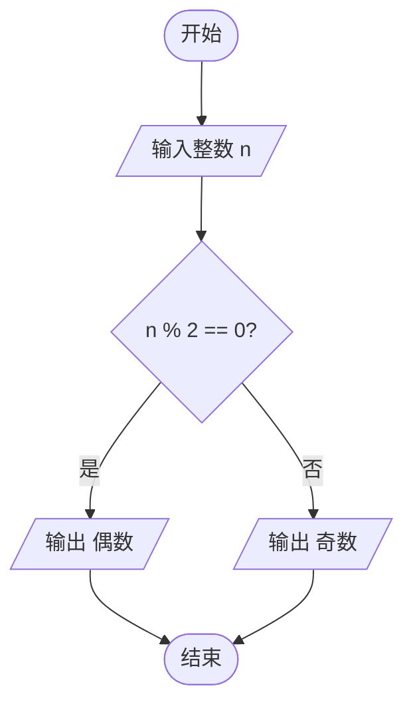
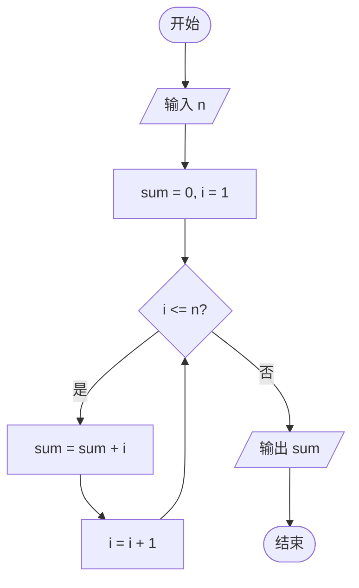

# 01. 算法初探

## 1. 算法是什么？

**算法（Algorithm）** 是一组明确定义的指令，用于解决特定问题或完成特定任务。它是计算的核心，通常以有限的步骤将输入转化为输出。

简单来说，**算法就是“解决问题的步骤”**。

比如你要做一道番茄炒蛋：
1. 准备番茄和鸡蛋（输入）
2. 切番茄、打鸡蛋
3. 热锅、倒油
4. 先炒鸡蛋、盛出
5. 再炒番茄、加入鸡蛋
6. 装盘（输出）

这就是一个“做番茄炒蛋”的算法！

**算法的三大关键特性：**

- **确定性**：每一步骤明确无歧义。不能出现“加适量盐”这种模糊描述。
- **有限性**：算法在有限步骤内必须结束。不能无限循环下去。
- **有效性**：每一步操作简单且可执行。不能是“用魔法让菜变熟”。

## 2. 为什么学算法？

```cpp
// 两个程序做同一件事——在书中查找某个字
// 方法一：从第1页翻到最后一页（顺序查找）
for (int i = 1; i <= 1000; i++) {
    // 检查第 i 页
}

// 方法二：利用目录直接翻到目标页码（二分查找）
// 只需要查约10次就能找到！
```

**学习算法的价值：**

- **写出更高效的程序**——同样的功能，好算法快几百倍。
- **解决更复杂的问题**——排序、搜索、路径规划等都需要算法。
- **面试和竞赛的必备技能**——算法是衡量编程能力的标尺。

::: info 注意
程序 = 数据结构 + 算法

这个公式是计算机科学家 Niklaus Wirth 提出的经典观点。数据结构决定数据怎么**存**，算法决定数据怎么**算**。
:::

## 3. 伪代码

**伪代码（Pseudocode）** 是一种用自然语言和简单结构来描述算法的工具。它不需要遵循严格的语法，重在表达逻辑思路。

**计算阶乘的伪代码：**

```text
Function Factorial(n)
    If n == 0 Then
        Return 1
    Else
        Return n * Factorial(n-1)
    End If
End Function
```

**用中文写伪代码——找最大值：**

```text
开始
    设置变量 max
    输入第 1 个数字，存入 max
    重复 9 次：
        输入下一个数字，存入 num
        如果 num > max：
            把 max 更新为 num
    输出 max
结束
```

::: tip 提示
伪代码没有严格语法要求，核心目的是**理清思路**。你可以用英文、中文、甚至中英混写，自己看得懂就行。
:::

## 4. 流程图

**流程图** 用图形化的方式展示算法的执行流程，比文字更直观。

**常用符号：**

| 符号 | 形状 | 含义 |
|------|------|------|
| 开始/结束 | 圆角矩形 / 椭圆 | 程序的起点和终点 |
| 处理 | 矩形 | 计算或操作 |
| 判断 | 菱形 | 条件分支 |
| 输入/输出 | 平行四边形 | 读取数据或显示结果 |
| 流程线 | 箭头 | 表示执行方向 |

**示例：判断一个数是否为偶数的流程图**



**示例：计算 1 到 n 的和**



::: tip 提示
流程图特别适合展示**循环**和**分支**结构。在你写代码之前，先用流程图理清逻辑，可以减少很多 bug。
:::

## 5. 时间复杂度

### 5.1 什么是时间复杂度？

**时间复杂度** 描述的是算法执行时间随输入规模增长而变化的趋势，用**大O记号（Big O notation）** 表示。

它不关心“具体跑了多少毫秒”，而是关心“数据量变大时，时间会怎么增长”。

### 5.2 常见的时间复杂度

| 记号 | 名称 | 含义 | 示例 |
|------|------|------|------|
| **O(1)** | 常数时间 | 无论数据多大，时间固定 | 访问数组元素 `arr[5]` |
| **O(log n)** | 对数时间 | 数据翻倍，时间只+1 | 二分查找 |
| **O(n)** | 线性时间 | 时间和数据量成正比 | 遍历数组 |
| **O(n²)** | 平方时间 | 数据翻倍，时间变 4 倍 | 冒泡排序（嵌套循环）|
| **O(2ⁿ)** | 指数时间 | 数据+1，时间翻倍 | 未优化的递归斐波那契 |

**直观感受：n = 100 时各复杂度表现**

```cpp
// O(1) —— 不管 n 是 100 还是 1亿，都只执行1次
int a = arr[50];

// O(n) —— n=100 时执行100次
for (int i = 0; i < n; i++) {
    cout << arr[i] << endl;
}

// O(n²) —— n=100 时执行10000次
for (int i = 0; i < n; i++) {
    for (int j = 0; j < n; j++) {
        cout << i << "," << j << endl;
    }
}
```

### 5.3 如何分析时间复杂度

**步骤：**

1. 找出核心操作（比较、赋值、循环等）。
2. 统计操作次数与输入规模 n 的关系。
3. 保留最高阶项，忽略常数和低阶项。

**示例：分析求和程序**

```cpp
int sum = 0;                    // O(1)
for (int i = 1; i <= n; i++) {  // 循环 n 次
    sum += i;                   // O(1) 每次执行
}
cout << sum << endl;            // O(1)
```

总时间 = O(1) + n × O(1) + O(1) = **O(n)**

**示例：分析嵌套循环**

```cpp
for (int i = 0; i < n; i++) {
    for (int j = 0; j < n; j++) {
        cout << "*";   // 执行 n × n = n² 次
    }
}
```

总时间 = **O(n²)**

## 6. 空间复杂度

**空间复杂度** 描述算法运行时占用的内存空间随输入规模增长的趋势。

| 记号 | 含义 | 示例 |
|------|------|------|
| **O(1)** | 只用了固定数量的额外变量 | 交换两个数 |
| **O(n)** | 额外创建了一个大小为 n 的数组 | 复制数组 |

```cpp
// O(1) —— 只用了几个变量
int sum = 0;
for (int i = 0; i < n; i++) {
    sum += arr[i];
}

// O(n) —— 额外创建了一个大小相同的数组
int* copy = new int[n];
for (int i = 0; i < n; i++) {
    copy[i] = arr[i];
}
delete[] copy;
```

::: info 注意
时间复杂度和空间复杂度往往需要**权衡**（trade-off）。有时候可以用更多内存来换取更快的速度（比如用哈希表缓存结果），有时候可以牺牲速度来节省内存。
:::

## 7. 小结

- **算法** 就是解决问题的步骤，必须具备确定性、有限性和有效性。
- **伪代码** 和 **流程图** 是描述算法的两种常用工具。
- **时间复杂度** 衡量程序跑得多快，**空间复杂度** 衡量程序占多少内存。
- **大O记号** 描述增长率，只保留最高阶项。
- 常见复杂度：O(1) < O(log n) < O(n) < O(n log n) < O(n²) < O(2ⁿ)

## 8. 练习

1. 画出“输入三个数，输出最大值”的流程图。

2. 以下程序的时间复杂度是多少？
   ```cpp
   for (int i = 0; i < n; i += 2) {
       cout << i << endl;
   }
   ```

3. 以下程序的时间复杂度是多少？
   ```cpp
   for (int i = 0; i < n; i++) {
       for (int j = 0; j < i; j++) {
           cout << "*";
       }
   }
   ```
   > 提示：当 i=0 时内层执行 0 次，i=1 时执行 1 次……i=n-1 时执行 n-1 次。总次数 = 0+1+2+...+(n-1) = ?

4. 用伪代码描述“判断一个数是否为素数”的算法。

5. 为什么说“O(n²) 的算法在 n 很大的时候不可用”？当 n=10000 时，O(n²) 大约需要执行多少次操作？
