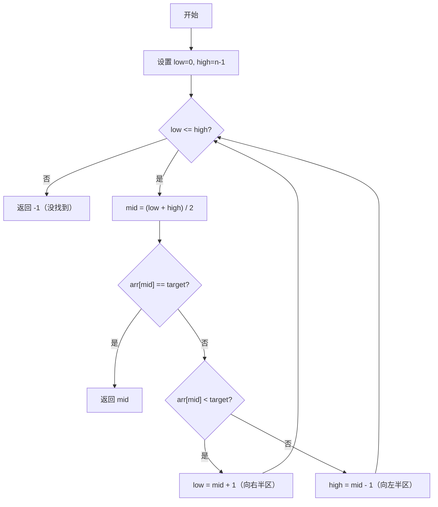

# 03. 查找算法

在编程中，我们经常需要在一组数据里找到某个特定的元素。比如：

- 在通讯录里找到某人的电话号码。
- 在成绩单里找到某个学生的分数。
- 在字典里找到某个单词的解释。

**查找算法** 就是完成这类任务的方法。不同的查找算法效率差异很大，选择合适的查找方法可以让程序快几十倍甚至上千倍。

## 1. 顺序查找（线性查找）

### 1. 基本思想

顺序查找是最简单的查找方法——**从第一个元素开始，逐个检查，直到找到目标或遍历完所有元素。**

> 就像在一堆扑克牌里找红桃 A，你一张一张地翻，直到找到为止。

### 2. 适用场景

- 数据**无序**时唯一的选择。
- 数据量**较小**时完全够用。
- 实现简单，不需要任何预处理。

### 3. 代码实现

```cpp
#include <iostream>
using namespace std;

// 顺序查找：返回目标值的下标，没找到返回 -1
int sequentialSearch(int arr[], int n, int target) {
    for (int i = 0; i < n; i++) {
        if (arr[i] == target) {
            return i;  // 找到了，返回下标
        }
    }
    return -1;  // 没找到
}

int main() {
    int arr[] = {5, 3, 8, 1, 9, 2, 7};
    int n = sizeof(arr) / sizeof(arr[0]);
    int target = 8;

    int result = sequentialSearch(arr, n, target);

    if (result != -1) {
        cout << "找到了！目标值 " << target << " 在下标 " << result << " 处。" << endl;
    } else {
        cout << "没找到目标值 " << target << endl;
    }

    return 0;
}
```

输出：

```text
找到了！目标值 8 在下标 2 处。
```

### 4. 复杂度分析

| 情况 | 说明                   | 时间复杂度 |
| ---- | ---------------------- | ---------- |
| 最好 | 目标在第一个位置       | O(1)       |
| 最坏 | 目标在最后一个或不存在 | O(n)       |
| 平均 | 随机分布               | O(n)       |

- **空间复杂度**：O(1)，只用了几个变量。

::: tip 提示
顺序查找虽然“笨”，但它是**万能的**——不要求数据有序，不要求数据结构特殊，任何情况下都能用。
:::

## 2. 二分查找（折半查找）

### 1. 基本思想

二分查找通过**反复将查找区间分成两半**，每次排除一半的数据，快速缩小范围。

> 就像你在字典里查一个单词——你不会从第一页翻到最后一页，而是先翻到中间，看看目标在左边还是右边，然后继续折半。

**前提条件：数据必须是有序的（升序或降序）。**

### 2. 工作原理

假设要在升序数组 `[1, 3, 5, 7, 9, 11, 13]` 中查找 `7`：

```text
第1步：区间 [0, 6]，中间下标 3，值 7 → 找到了！✅
```

更详细的例子——查找 `9`：

```text
第1步：区间 [0, 6]，中间下标 3 → 值 7 < 9，向右半区查找
第2步：区间 [4, 6]，中间下标 5 → 值 11 > 9，向左半区查找
第3步：区间 [4, 4]，中间下标 4 → 值 9 == 9，找到了！✅
```



### 3. 代码实现

```cpp
#include <iostream>
using namespace std;

// 二分查找（循环实现）：返回目标值的下标，没找到返回 -1
int binarySearch(int arr[], int n, int target) {
    int low = 0;
    int high = n - 1;

    while (low <= high) {
        int mid = (low + high) / 2;  // 或者 low + (high - low) / 2 防止溢出

        if (arr[mid] == target) {
            return mid;          // 找到了
        } else if (arr[mid] < target) {
            low = mid + 1;       // 向右半区查找
        } else {
            high = mid - 1;      // 向左半区查找
        }
    }

    return -1;  // 没找到
}

int main() {
    int arr[] = {1, 3, 5, 7, 9, 11, 13, 15, 17};
    int n = sizeof(arr) / sizeof(arr[0]);

    int targets[] = {7, 9, 2, 15};
    for (int i = 0; i < 4; i++) {
        int result = binarySearch(arr, n, targets[i]);
        if (result != -1) {
            cout << "找到了 " << targets[i] << "，下标为 " << result << endl;
        } else {
            cout << "没找到 " << targets[i] << endl;
        }
    }

    return 0;
}
```

输出：

```text
找到了 7，下标为 3
找到了 9，下标为 4
没找到 2
找到了 15，下标为 7
```

### 4. 复杂度分析

| 情况 | 说明             | 时间复杂度 |
| ---- | ---------------- | ---------- |
| 最好 | 目标就在中间位置 | O(1)       |
| 最坏 | 一直找到区间为空 | O(log n)   |
| 平均 | 随机分布         | O(log n)   |

**为什么是 O(log n)？**

每次二分查找都会把查找范围**缩小一半**。假设有 n 个元素：

- 第 1 次比较后，范围缩小到 n/2
- 第 2 次比较后，范围缩小到 n/4
- 第 3 次比较后，范围缩小到 n/8
- ……
- 第 k 次比较后，范围缩小到 n / 2^k

当范围缩小到 1 时：n / 2^k = 1，即 2^k = n，k = log₂n

所以最多需要 **log₂n** 次比较。

::: tip 提示
**O(log n) 有多快？**

- n = 1000 时，二分查找最多比较 **10 次**（2¹⁰ = 1024）
- n = 1000000 时，最多比较 **20 次**（2²⁰ ≈ 100 万）
- 顺序查找在 n=1000000 时最坏需要比较 **100 万次**
:::

## 3. 顺序查找 vs 二分查找

| 对比项         | 顺序查找           | 二分查找           |
| -------------- | ------------------ | ------------------ |
| 数据要求       | 无序/有序均可      | **必须有序** |
| 时间复杂度     | O(n)               | O(log n)           |
| 空间复杂度     | O(1)               | O(1)               |
| 实现难度       | 非常简单           | 中等               |
| 适用场景       | 小数据量、无序数据 | 大数据量、有序数据 |
| 是否可提前退出 | 找到即可退出       | 找到 mid 即返回；区间为空说明没找到 |

**选择建议：**

- 如果数据量**很小**（比如几十个）→ 顺序查找就够了。
- 如果数据量**很大**且**有序** → 必须用二分查找。
- 如果数据**无序** → 要么先用排序算法排序再用二分查找，要么直接用顺序查找。

::: warning 警告
**二分查找的前提是数组必须有序！** 如果对一个无序数组使用二分查找，结果就是完全错误的。一定记住要先排序。
:::

## 4. 额外：二分查找的递归实现

前面我们用循环实现了二分查找，其实也可以用递归来实现：

```cpp
#include <iostream>
using namespace std;

int binarySearchRecursive(int arr[], int low, int high, int target) {
    if (low > high) {
        return -1;  // 没找到，递归结束
    }

    int mid = (low + high) / 2;

    if (arr[mid] == target) {
        return mid;  // 找到了
    } else if (arr[mid] < target) {
        // 向右半区递归查找
        return binarySearchRecursive(arr, mid + 1, high, target);
    } else {
        // 向左半区递归查找
        return binarySearchRecursive(arr, low, mid - 1, target);
    }
}

int main() {
    int arr[] = {10, 20, 30, 40, 50, 60, 70};
    int n = sizeof(arr) / sizeof(arr[0]);

    int target = 40;
    int result = binarySearchRecursive(arr, 0, n - 1, target);

    if (result != -1) {
        cout << "找到了 " << target << "，下标为 " << result << endl;
    } else {
        cout << "没找到 " << target << endl;
    }

    return 0;
}
```

## 5. 小结

- **顺序查找**：逐个比较，简单通用，O(n)。
- **二分查找**：折半搜索，必须有序，O(log n) —— 效率远高于顺序查找。
- 选择哪种查找方法，取决于**数据是否有序**和**数据量的大小**。
- 二分查找可以用**循环**或**递归**两种方式实现。

## 6. 练习

1. 在有序数组 `[2, 5, 8, 12, 16, 23, 38, 45, 56, 72]` 中查找 `23`，写出二分查找每次比较的 low、high、mid 值。
2. 编写一个程序，输入 10 个整数和一个目标值，使用顺序查找找目标值并输出它的下标（如果存在则输出下标，否则输出“未找到”）。
3. 编写一个程序，输入一个有序数组和一个目标值，使用二分查找找到目标值并输出下标。
4. 用一个大小为 100000 的有序数组，分别用顺序查找和二分查找查找同一个目标值，比较它们需要的比较次数（提示：在查找函数里加一个计数器）。
5. 修改二分查找，让它返回第一个大于等于目标值的元素下标（C++ 标准库中 `lower_bound` 的功能）。
6. 一个有序数组在某一点被旋转了（比如 `[4,5,6,7,0,1,2]`），请设计一个算法在这个旋转数组中查找目标值。提示：先用二分查找找到旋转点，再在对应的半区查找。
