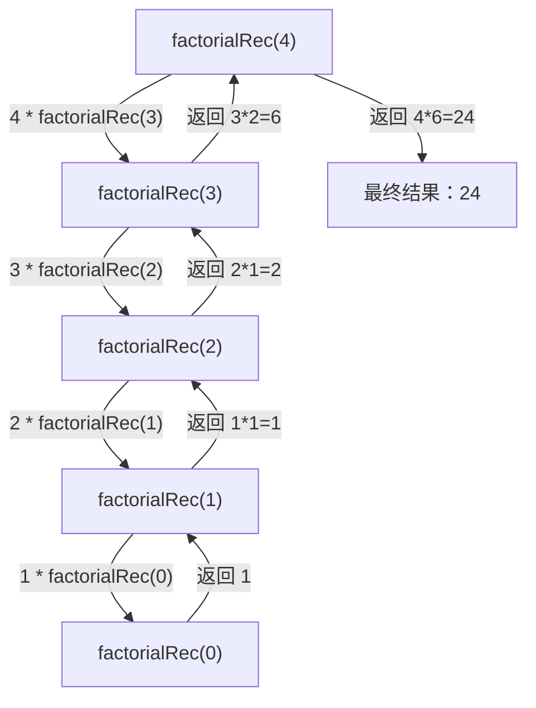

# 04. 递归

## 1. 什么是递归？

**递归（Recursion）** 就是**函数在运行过程中调用它自己**。但必须给自己一个**停下来的条件**。

听起来有点绕？看看生活中的例子：

> 你站在一面镜子前，镜子里有另一个你拿着镜子，镜中镜里还有更小的你拿着镜子……这就形成了“无限递归”。
>
> 但你只需要说“停！最小的那个镜子里的我不用再照了”——这就是**基例**。

**递归函数通常包含两部分：**

1. **基例（Base Case）**：递归的结束条件。没有它，递归会无限调用下去，直到程序崩掉（栈溢出）。
2. **递归调用（Recursive Call）**：函数在某个条件下调用自己，把问题规模缩小。

```text
返回值类型 函数名(参数) {
    if (满足结束条件) {    // 基例
        return 结果;
    }
    // 递归调用（参数比上一次更接近基例）
    return 函数名(缩小后的参数);
}
```

::: info 注意
每一次递归调用，问题的规模必须比上一次小，直到触碰到基例。这是递归能够结束的保证。
:::

## 2. 阶乘：递归的经典入门

阶乘的定义：
$$
n! = n \times (n-1) \times (n-2) \times \cdots \times 2 \times 1
$$

特殊约定：**0! = 1**

### 1. 用迭代（循环）实现

```cpp
#include <iostream>
using namespace std;

int factorialIter(int n) {
    int result = 1;
    for (int i = 1; i <= n; i++) {
        result *= i;
    }
    return result;
}

int main() {
    cout << "5! = " << factorialIter(5) << endl;  // 120
    return 0;
}
```

### 2. 用递归实现

递归的思路：**n! = n × (n-1)!**

- 5! = 5 × 4!
- 4! = 4 × 3!
- 3! = 3 × 2!
- 2! = 2 × 1!
- 1! = 1 × 0!
- 0! = 1 ← **基例！**

```cpp
#include <iostream>
using namespace std;

int factorialRec(int n) {
    // 基例：0! = 1
    if (n == 0) {
        return 1;
    }
    // 递归调用：n! = n * (n-1)!
    return n * factorialRec(n - 1);
}

int main() {
    for (int i = 0; i <= 7; i++) {
        cout << i << "! = " << factorialRec(i) << endl;
    }
    return 0;
}
```

输出：
```text
0! = 1
1! = 1
2! = 2
3! = 6
4! = 24
5! = 120
6! = 720
7! = 5040
```

### 3. 递归的执行过程

当调用 `factorialRec(4)` 时，发生了什么？



用文字描述就是：

```text
factorialRec(4) 调用 factorialRec(3)
    factorialRec(3) 调用 factorialRec(2)
        factorialRec(2) 调用 factorialRec(1)
            factorialRec(1) 调用 factorialRec(0)
                factorialRec(0) 返回 1  ← 触碰到基例！
            factorialRec(1) 返回 1 * 1 = 1
        factorialRec(2) 返回 2 * 1 = 2
    factorialRec(3) 返回 3 * 2 = 6
factorialRec(4) 返回 4 * 6 = 24
```

::: tip 提示
递归分为两个阶段：

1. **递推**：一层层调用下去，直到碰到基例（对应图中自上而下的一层层调用）。
2. **回归**：从基例开始一层层返回结果（对应图中自下而上的一层层返回）。
:::

## 3. 函数调用栈

**栈（Stack）** 是一种“后进先出”的数据结构，就像一摞盘子——最后放上去的盘子最先被拿走。

### 1. 递归与栈的关系

每次调用函数时，C++ 会把函数的**局部变量**和**返回地址**压入**调用栈**。函数返回时，从栈中弹出。

**递归的执行过程就是栈的压入和弹出：**

```text
调用 factorialRec(4) → 压栈 [factorialRec(4)]
调用 factorialRec(3) → 压栈 [factorialRec(4), factorialRec(3)]
调用 factorialRec(2) → 压栈 [factorialRec(4), factorialRec(3), factorialRec(2)]
调用 factorialRec(1) → 压栈 [factorialRec(4), factorialRec(3), factorialRec(2), factorialRec(1)]
调用 factorialRec(0) → 压栈 [factorialRec(4), factorialRec(3), factorialRec(2), factorialRec(1), factorialRec(0)]
factorialRec(0) 返回 → 弹栈 [factorialRec(4), factorialRec(3), factorialRec(2), factorialRec(1)]
factorialRec(1) 返回 → 弹栈 [factorialRec(4), factorialRec(3), factorialRec(2)]
factorialRec(2) 返回 → 弹栈 [factorialRec(4), factorialRec(3)]
factorialRec(3) 返回 → 弹栈 [factorialRec(4)]
factorialRec(4) 返回 → 弹栈 []
```

### 2. 栈溢出

如果递归没有基例，或者递归太深，栈空间会被耗尽，导致**栈溢出（Stack Overflow）**：

```cpp
void infiniteRecursion(int n) {
    // 没有基例！永远递归下去
    cout << n << endl;
    infiniteRecursion(n + 1);  // 总有一天栈空间会耗尽
}
```

::: warning 警告
C++ 的递归深度是有限的（通常几千层）。在实际编程中，如果递归深度可能很大，应该改用循环或尾递归优化。
:::

## 4. 斐波那契数列

斐波那契数列由意大利数学家斐波那契在 1202 年提出，用来解决一个经典的兔子繁殖问题。

**数列定义：**

$$
F_0 = 0, \quad F_1 = 1, \quad F_n = F_{n-1} + F_{n-2}, \quad (n \geq 2)
$$

数列的前几项：0, 1, 1, 2, 3, 5, 8, 13, 21, 34, 55, ...

### 1. 递归实现

```cpp
#include <iostream>
using namespace std;

int fib(int n) {
    if (n == 0) return 0;     // 基例1
    if (n == 1) return 1;     // 基例2
    return fib(n - 1) + fib(n - 2);  // 递归调用
}

int main() {
    cout << "fib(10) = " << fib(10) << endl;  // 55
    return 0;
}
```

### 2. 递归调用过程（fib(5)）

```text
fib(5)
= fib(4) + fib(3)
= (fib(3) + fib(2)) + (fib(2) + fib(1))
= ((fib(2) + fib(1)) + (fib(1) + fib(0))) + ((fib(1) + fib(0)) + 1)
= (((fib(1) + fib(0)) + 1) + (1 + 0)) + ((1 + 0) + 1)
= ((1 + 0) + 1) + (1 + 0) + (1 + 0) + 1
= 5
```

::: warning 警告
这种朴素的递归求斐波那契效率极低！时间复杂度是 **O(2ⁿ)** —— n=50 时几乎算不出来。

原因是大量重复计算：`fib(3)` 被算了 2 次，`fib(2)` 被算了 3 次，`fib(1)` 被算了 5 次……

后面我们会学到用“记忆化”或“循环”来优化。
:::

### 3. 用循环实现（推荐）

```cpp
int fibIter(int n) {
    if (n == 0) return 0;
    if (n == 1) return 1;

    int a = 0, b = 1, c;
    for (int i = 2; i <= n; i++) {
        c = a + b;
        a = b;
        b = c;
    }
    return b;
}
```

循环版本的效率是 **O(n)**，比递归的 O(2ⁿ) 快非常多！

## 5. 汉诺塔

汉诺塔是一个经典的递归问题，完美展示了递归的思维方式。

**问题描述：**

有三根柱子（A、B、C），A 柱上有 n 个大小不同的圆盘，按从大到小从下往上叠放。要求将所有圆盘从 A 移到 C，每次只能移动一个圆盘，且**大圆盘不能放在小圆盘上面**。

**递归思路：**

1. 先把上面 n-1 个盘子从 A 移到 B（借助 C）。
2. 把最大的盘子从 A 移到 C。
3. 再把 n-1 个盘子从 B 移到 C（借助 A）。

```cpp
#include <iostream>
using namespace std;

void hanoi(int n, char from, char to, char aux) {
    // 基例：只有一个盘子，直接移动
    if (n == 1) {
        cout << "移动盘子 1 从 " << from << " 到 " << to << endl;
        return;
    }

    // 1. 将 n-1 个盘子从 from 移到 aux（借助 to）
    hanoi(n - 1, from, aux, to);

    // 2. 将最大的盘子从 from 移到 to
    cout << "移动盘子 " << n << " 从 " << from << " 到 " << to << endl;

    // 3. 将 n-1 个盘子从 aux 移到 to（借助 from）
    hanoi(n - 1, aux, to, from);
}

int main() {
    int n = 3;
    cout << "汉诺塔 " << n << " 个盘子的移动步骤：" << endl;
    hanoi(n, 'A', 'C', 'B');
    return 0;
}
```

输出：
```text
汉诺塔 3 个盘子的移动步骤：
移动盘子 1 从 A 到 C
移动盘子 2 从 A 到 B
移动盘子 1 从 C 到 B
移动盘子 3 从 A 到 C
移动盘子 1 从 B 到 A
移动盘子 2 从 B 到 C
移动盘子 1 从 A 到 C
```

::: info 注意
汉诺塔的移动次数是 **2ⁿ - 1**。n=64 时需要移动 2⁶⁴ - 1 ≈ 1.8 × 10¹⁹ 次，就算每秒移动一次，也需要约 5800 亿年！
:::

## 6. 递归 vs 循环

| 对比项 | 递归 | 循环 |
|--------|------|------|
| 思路 | 把大问题分解成小问题 | 逐步执行，直到条件满足 |
| 代码可读性 | 某些问题（如汉诺塔）很清晰 | 简单问题时更直观 |
| 性能 | 有函数调用开销，可能栈溢出 | 高效，没有额外开销 |
| 适用场景 | 树、图、分治、回溯等问题 | 大多数日常编程场景 |

::: tip 提示
递归的核心思维：**不要纠结于“怎么一步步执行”，而是要找到“大问题和小问题之间的关系”**。

写递归时，你只需要想清楚两件事：

1. **基例是什么？**（什么时候停止递归）
2. **如何把问题缩小？**（当前步骤和下一步的关系）
:::

## 7. 小结

- **递归** 是函数调用自身的编程方式。
- 递归函数必须包含**基例**（结束条件）和**递归调用**（缩小问题规模）。
- 递归的执行过程对应**函数调用栈**的压栈和弹栈。
- 递归适合解决“可以分解为相同子问题”的场景（阶乘、斐波那契、汉诺塔）。
- **递归不一定总是最好的选择**——如果循环能解决，优先用循环。

## 8. 练习

1. 用递归实现函数 `int sum(int n)`，计算 1 + 2 + 3 + ... + n 的值。

2. 用递归实现函数 `void printReverse(int n)`，输入一个正整数，逆序输出它的每一位。例如输入 `12345`，输出 `54321`。

3. 用递归实现函数 `int power(int base, int exp)`，计算 base 的 exp 次方（exp ≥ 0）。

4. 用递归实现辗转相除法求两个数的最大公约数。
   > 公式：gcd(a, b) = gcd(b, a % b)，基例：gcd(a, 0) = a

5. 使用“记忆化”（数组缓存中间结果）优化递归斐波那契，将时间复杂度从 O(2ⁿ) 降到 O(n)。

6. 编写程序，输入 n，输出汉诺塔的**最少移动步数**（不允许用公式 2ⁿ-1，必须用递归思路计数）。
