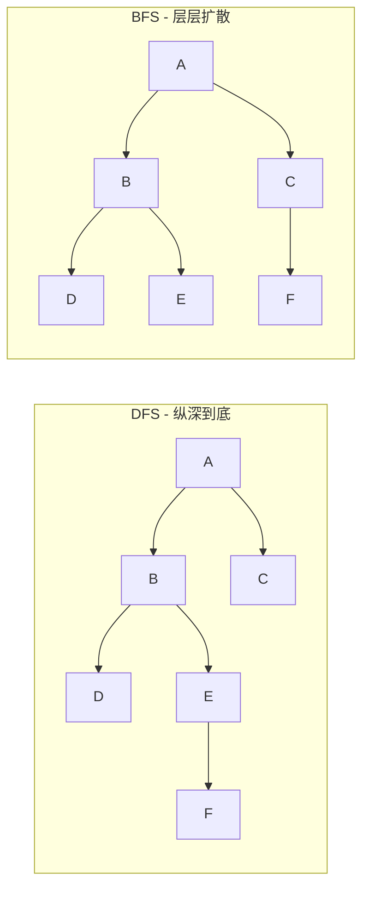
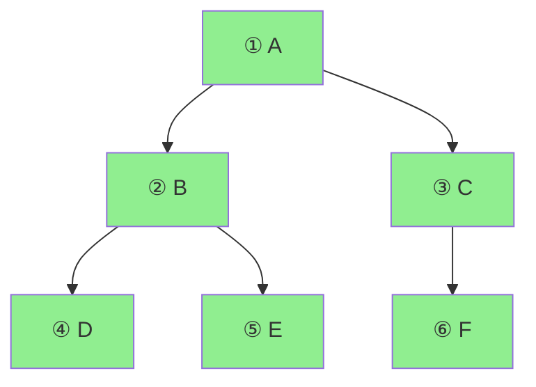

# 🌊 广度搜索算法（BFS）

## 一、什么是广度优先搜索？🤔

**广度优先搜索（Breadth-First Search，简称 BFS）** 是一种**逐层向外扩张**的搜索策略。

> 想象你在湖边扔下一颗石子：
> - 石子落水的地方是**起点**
> - 水波一圈一圈向外扩散
> - 先扩散到离起点最近的地方
> - 再扩散到更远的地方

这就是 BFS 的核心思想——**"由近及远，层层推进"**。

### 与 DFS 的对比



| 对比 | DFS（深度优先） | BFS（广度优先） |
|------|---------------|---------------|
| 策略 | 一条路走到黑 | 逐层推进 |
| 数据结构 | **栈**（后进先出） | **队列**（先进先出） |
| 实现方式 | 递归或显式栈 | 循环 + 队列 |
| 保证最短路径？ | ❌ 不一定 | ✅ **一定能找到最短路径** |

> [!note]
> BFS 最重要的特性：**在无权图中，BFS 第一次访问到目标节点时，走的路径一定是最短路径！** 这是 BFS 比 DFS 最核心的优势。

## 二、队列 —— BFS 的核心数据结构 📋

**队列（Queue）** 是一种"先进先出（FIFO, First In First Out）"的数据结构。

> 就像在奶茶店排队：**先来的人先买到奶茶，后来的人排在后面**。

```python
from collections import deque  # deque 是双端队列，高效实现队列

# 创建队列
queue = deque()

# 入队（从右边添加）
queue.append('A')
queue.append('B')
queue.append('C')
print(queue)  # deque(['A', 'B', 'C'])

# 出队（从左边取出）
first = queue.popleft()  # 'A'
print(first)             # A
print(queue)             # deque(['B', 'C'])

# 判断是否为空
print(len(queue) == 0)   # False
```

> [!tip]
> Python 的 `list` 虽然也能模拟队列（用 `pop(0)`），但效率很低。因为 `pop(0)` 需要移动所有后面的元素，时间复杂度是 **O(n)**。
>
> 应该使用 `collections.deque`，它的 `popleft()` 是 **O(1)** 的。

## 三、BFS 的实现 🛠️

### 1. 基本模板

```python
from collections import deque

def bfs(graph, start):
    """
    graph: 图的邻接表
    start: 起始节点
    """
    visited = set()         # 已访问节点
    queue = deque([start])  # 初始化队列
    visited.add(start)      # 标记起点为已访问
    
    while queue:
        node = queue.popleft()   # 取出队首元素
        print(node, end=' → ')   # 访问当前节点
        
        for neighbor in graph[node]:   # 遍历所有邻居
            if neighbor not in visited:
                visited.add(neighbor)   # 入队前就标记为已访问
                queue.append(neighbor)  # 将邻居入队
    print("END")
```

### 2. 完整示例

```python
from collections import deque

# 定义图（邻接表）
graph = {
    'A': ['B', 'C'],
    'B': ['A', 'D', 'E'],
    'C': ['A', 'F'],
    'D': ['B'],
    'E': ['B', 'F'],
    'F': ['C', 'E']
}

def bfs(graph, start):
    """广度优先搜索"""
    visited = set()
    queue = deque([start])
    visited.add(start)
    
    while queue:
        node = queue.popleft()
        print(node, end=' → ')
        
        for neighbor in graph[node]:
            if neighbor not in visited:
                visited.add(neighbor)
                queue.append(neighbor)
    print("END")

print("BFS 遍历顺序：", end='')
bfs(graph, 'A')
```

输出：
```
BFS 遍历顺序：A → B → C → D → E → F → END
```

**遍历过程图解：**



**执行过程拆解：**

```
初始：         队列 = [A]               已访问 = {A}
第1步：出队 A → 加入 B,C              队列 = [B, C]        已访问 = {A, B, C}
第2步：出队 B → 加入 D,E              队列 = [C, D, E]     已访问 = {A, B, C, D, E}
第3步：出队 C → 加入 F                队列 = [D, E, F]     已访问 = {A, B, C, D, E, F}
第4步：出队 D → D的邻居B已访问        队列 = [E, F]
第5步：出队 E → E的邻居B,F已访问      队列 = [F]
第6步：出队 F → F的邻居C,E已访问      队列 = []
```

> [!tip]
> BFS 的关键区别在于**队列**和**"入队时就标记已访问"**。
>
> 为什么入队时就标记？因为如果不这样做，同一个节点可能会被多次加入队列，造成重复访问和无限循环。

## 四、BFS 求最短路径 🗺️

BFS 最强大的功能——**在无权图中找最短路径**。

```python
from collections import deque

def bfs_shortest_path(graph, start, end):
    """BFS 求从 start 到 end 的最短路径"""
    visited = set()
    queue = deque([[start]])  # 队列中存储的是路径，而不仅仅是节点
    visited.add(start)
    
    while queue:
        path = queue.popleft()      # 取出当前路径
        node = path[-1]             # 路径的最后一个节点
        
        if node == end:
            return path             # 找到了！返回完整路径
        
        for neighbor in graph[node]:
            if neighbor not in visited:
                visited.add(neighbor)
                new_path = list(path)   # 复制当前路径
                new_path.append(neighbor)  # 加入新节点
                queue.append(new_path)
    
    return None  # 没有找到路径

# 测试
graph = {
    'A': ['B', 'C'],
    'B': ['A', 'D', 'E'],
    'C': ['A', 'F', 'G'],
    'D': ['B'],
    'E': ['B', 'H'],
    'F': ['C'],
    'G': ['C', 'H'],
    'H': ['E', 'G']
}

path = bfs_shortest_path(graph, 'A', 'H')
print(f"最短路径：{' → '.join(path)}")
# 输出：A → C → G → H（也可能是 A → B → E → H，取决于邻居顺序）
```

**BFS 为什么能找到最短路径？**

因为 BFS 是一层一层扩散的：
- 第 1 轮：访问距离为 1 的所有节点
- 第 2 轮：访问距离为 2 的所有节点
- 第 k 轮：访问距离为 k 的所有节点

**第一次**遇到目标节点时，路径长度就是**最短的**！

> [!warning]
> BFS 保证的是**路径长度最短**（经过的边最少），而不是"加权最短"（权重和最小）。如果边有不同权重，需要用 Dijkstra 算法。

## 五、BFS 的应用场景 🎯

### 1. 二叉树的层序遍历

BFS 非常自然地对应了二叉树的**层序遍历**——一层一层地访问节点：

```python
from collections import deque

class TreeNode:
    def __init__(self, val):
        self.val = val
        self.left = None
        self.right = None

def level_order(root):
    """二叉树的层序遍历（BFS）"""
    if not root:
        return []
    
    result = []
    queue = deque([root])
    
    while queue:
        level_size = len(queue)  # 当前层的节点数
        level_nodes = []
        
        for _ in range(level_size):
            node = queue.popleft()
            level_nodes.append(node.val)
            
            if node.left:
                queue.append(node.left)
            if node.right:
                queue.append(node.right)
        
        result.append(level_nodes)  # 当前层的结果
    
    return result

# 构建一棵树
#        1
#       / \
#      2   3
#     / \   \
#    4   5   6
root = TreeNode(1)
root.left = TreeNode(2)
root.right = TreeNode(3)
root.left.left = TreeNode(4)
root.left.right = TreeNode(5)
root.right.right = TreeNode(6)

print(level_order(root))  # [[1], [2, 3], [4, 5, 6]]
```

### 2. 计算从起点到所有节点的距离

```python
from collections import deque

def bfs_distance(graph, start):
    """计算从 start 到所有节点的最短距离"""
    distance = {start: 0}  # 存储每个节点到起点的距离
    queue = deque([start])
    
    while queue:
        node = queue.popleft()
        
        for neighbor in graph[node]:
            if neighbor not in distance:
                distance[neighbor] = distance[node] + 1
                queue.append(neighbor)
    
    return distance

graph = {
    'A': ['B', 'C'],
    'B': ['A', 'D', 'E'],
    'C': ['A', 'F'],
    'D': ['B'],
    'E': ['B', 'F'],
    'F': ['C', 'E']
}

dist = bfs_distance(graph, 'A')
for node, d in sorted(dist.items()):
    print(f"从 A 到 {node} 的最短距离：{d}")
```

输出：
```
从 A 到 A 的最短距离：0
从 A 到 B 的最短距离：1
从 A 到 C 的最短距离：1
从 A 到 D 的最短距离：2
从 A 到 E 的最短距离：2
从 A 到 F 的最短距离：2
```

### 3. 检测二分图

**二分图** 是指可以把所有节点分成两组，使得每条边都连接不同组的节点。BFS 可以检测一个图是否是二分图：

```python
from collections import deque

def is_bipartite(graph):
    """检测图是否是二分图"""
    color = {}  # 存储每个节点的颜色（0 或 1）
    
    for start in graph:
        if start in color:
            continue
        
        # 对新连通分量进行 BFS
        color[start] = 0
        queue = deque([start])
        
        while queue:
            node = queue.popleft()
            
            for neighbor in graph[node]:
                if neighbor not in color:
                    color[neighbor] = 1 - color[node]  # 涂上相反颜色
                    queue.append(neighbor)
                elif color[neighbor] == color[node]:
                    return False  # 相邻节点同色，不是二分图
    
    return True

# 测试
graph1 = {
    'A': ['B', 'C'],
    'B': ['A', 'D'],
    'C': ['A', 'D'],
    'D': ['B', 'C']
}
print(is_bipartite(graph1))  # True（可以分成 {A,D} 和 {B,C}）

graph2 = {
    'A': ['B', 'C'],
    'B': ['A', 'C'],  # B 和 C 也相连，形成奇环
    'C': ['A', 'B']
}
print(is_bipartite(graph2))  # False（三角形不是二分图）
```

## 六、BFS 和 DFS 的对比 📊

| 对比项 | BFS | DFS |
|--------|-----|-----|
| 数据结构 | **队列**（先进先出） | **栈**（后进先出） |
| 实现方式 | 循环 + 队列 | 递归或显式栈 |
| 空间复杂度 | O(V)（队列存储一层） | O(V)（递归栈深度） |
| 最短路径 | ✅ **一定能找到** | ❌ 不一定 |
| 遍历顺序 | 按距离逐层 | 沿一条路走到底 |
| 适用场景 | 最短路径、层级关系 | 连通性、回溯、排列组合 |

**时间复杂度相同**：O(V + E)（每个节点和每条边各处理一次）

> [!tip]
> **什么时候用 BFS，什么时候用 DFS？**
>
> **用 BFS：**
> - 需要找**最短路径**（如迷宫最短路线）
> - 问题与**层级/距离**有关（如社交网络的好友推荐）
> - 图的规模不太大（BFS 可能占用较多内存）
>
> **用 DFS：**
> - 只是判断**是否存在**路径或连通性
> - 需要枚举所有可能性（回溯法）
> - 图的深度较小（避免递归栈溢出）
> - 实现简单，代码简洁

## 七、BFS 总结 🎯

### BFS 的核心思想

1. **逐层扩散**：从起点出发，一层一层向外访问。
2. **队列驱动**：用队列（deque）记录每一层待访问的节点。
3. **先标记后入队**：入队时就标记为已访问，避免重复。

### BFS 适合解决的问题

| 问题类型 | 说明 |
|---------|------|
| 最短路径（无权图） | 两个节点之间边数最少的路径 |
| 层序遍历 | 树的按层遍历、图的按距离访问 |
| 连通分量 | 与 DFS 类似，也能统计 |
| 二分图检测 | 用两种颜色给节点染色 |
| 单词梯（Word Ladder） | 经典 BFS 面试题 |

## 八、练习 📝

1. **手动模拟 BFS**：给定图 `{A:[B,C], B:[A,D], C:[A,E,F], D:[B], E:[C], F:[C]}`，从 A 出发，写出 BFS 遍历顺序。

2. **实现 BFS**：编写函数 `bfs(graph, start)`，用队列实现广度优先遍历并输出遍历顺序。

3. **最短路径长度**：编写函数 `shortest_distance(graph, start, end)`，返回从 start 到 end 的最短路径长度（边数）。如果不存在路径，返回 -1。

4. **单词梯（Word Ladder）**：给定两个单词（如 `"hit"` 和 `"cog"`）和一个单词列表，每次可以改变一个字母，找出从起始单词到目标单词的最短变换路径长度。
   ```python
   begin = "hit"
   end = "cog"
   word_list = ["hot", "dot", "dog", "lot", "log", "cog"]
   # 最短路径：hit → hot → dot → dog → cog（长度 4）
   ```

5. **迷宫最短路径**：给定一个二维迷宫，`0` 表示可以走的路，`1` 表示墙。用 BFS 找出从左上角 `(0,0)` 到右下角的最短路径长度。
   ```python
   maze = [
       [0, 0, 1, 0],
       [1, 0, 1, 0],
       [0, 0, 0, 0],
       [0, 1, 1, 0]
   ]
   # 输出：6（路径长度）
   ```

6. **挑战题：被围绕的区域**：给定一个二维矩阵，包含 `'X'` 和 `'O'`，将所有被 `'X'` 围绕的 `'O'` 替换为 `'X'`。（提示：从边界的 `'O'` 开始 BFS，标记所有没有被围绕的 `'O'`）
   ```python
   board = [
       ['X', 'X', 'X', 'X'],
       ['X', 'O', 'O', 'X'],
       ['X', 'X', 'O', 'X'],
       ['X', 'O', 'X', 'X']
   ]
   # 输出：
   # ['X', 'X', 'X', 'X']
   # ['X', 'X', 'X', 'X']
   # ['X', 'X', 'X', 'X']
   # ['X', 'O', 'X', 'X']
   ```


