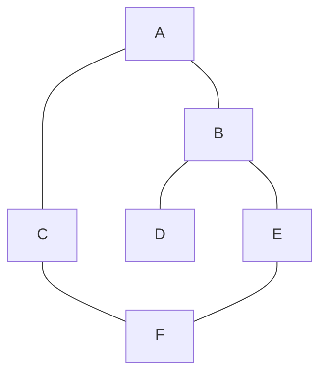
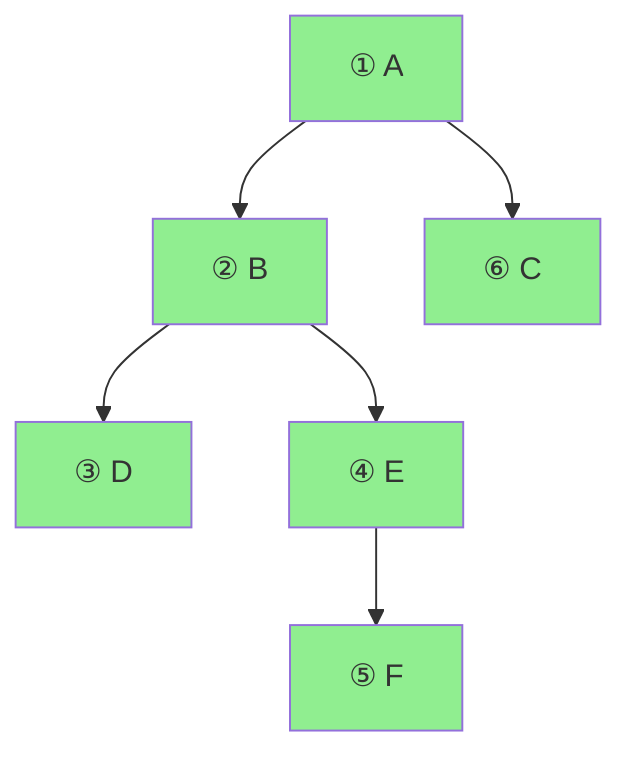

# 🧗 深度搜索算法（DFS）

## 一、什么是深度优先搜索？🤔

**深度优先搜索（Depth-First Search，简称 DFS）** 是一种**沿着一条路走到黑，走不通再回头**的搜索策略。

> 想象你在走迷宫：
> - 你选择一个岔路口走进去
> - 一直往前走，直到走不通（碰壁或已访问过）
> - 然后**原路返回**到上一个岔路口，尝试另一条路
> - 直到找到出口，或者所有路都走完

这就是 DFS 的核心思想——**"不撞南墙不回头"**。

### 核心特点

| 特点 | 说明 |
|------|------|
| 搜索策略 | 优先往深处走，直到无法继续再回溯 |
| 数据结构 | **栈**（后进先出 LIFO）—— 递归调用本质上就是栈 |
| 实现方式 | 递归（最常用）或显式栈 |
| 遍历顺序 | 沿着一条路径走到底，再回头 |

> [!note]
> 第4课学的**递归**，其实就是 DFS 的一种实现方式——函数调用栈在背后帮我们实现了"深入 → 回溯"的机制。

## 二、图的表示方法 🗺️

在学习 DFS 之前，我们需要先了解如何用代码表示一个"图"（Graph）。

图由**节点（顶点）** 和**边**组成。比如社交网络：

- 每个人是一个"节点"
- 朋友关系是一条"边"

### 邻接表（最常用的表示法）

```python
# 用字典表示图：键是节点，值是它的邻居列表
graph = {
    'A': ['B', 'C'],
    'B': ['A', 'D', 'E'],
    'C': ['A', 'F'],
    'D': ['B'],
    'E': ['B', 'F'],
    'F': ['C', 'E']
}
```

这个图的结构：



> [!tip]
> 邻接表是最常用的图存储方式，因为它**节省空间**（只存储存在的边），而且容易遍历邻居。

## 三、DFS 的递归实现 🔄

### 1. 基本模板

```python
def dfs(graph, node, visited):
    """
    graph: 图的邻接表
    node: 当前访问的节点
    visited: 已访问节点集合（用于避免重复访问）
    """
    if node in visited:      # 已经访问过了，跳过
        return
    
    visited.add(node)        # 标记为已访问
    print(node, end=' ')     # 访问当前节点（可以是其他操作）
    
    for neighbor in graph[node]:   # 遍历所有邻居
        dfs(graph, neighbor, visited)  # 递归访问邻居
```

### 2. 完整示例

```python
# 定义图（邻接表）
graph = {
    'A': ['B', 'C'],
    'B': ['A', 'D', 'E'],
    'C': ['A', 'F'],
    'D': ['B'],
    'E': ['B', 'F'],
    'F': ['C', 'E']
}

def dfs(graph, node, visited):
    """深度优先搜索（递归）"""
    if node in visited:
        return
    
    visited.add(node)
    print(node, end=' → ')
    
    for neighbor in graph[node]:
        dfs(graph, neighbor, visited)

# 从 A 开始遍历
visited = set()
print("DFS 遍历顺序：", end='')
dfs(graph, 'A', visited)
print("END")
```

输出：
```
DFS 遍历顺序：A → B → D → E → F → C → END
```

**遍历过程图解：**



遍历顺序：**A → B → D → E → F → C**

> A 出发，先去 B → B 先去 D（D 没有未访问的邻居）→ 回到 B → 去 E → E 先去 F → 回到 E（没有未访问的邻居）→ 回到 B → 回到 A → 去 C → 完成

## 四、DFS 的栈实现 📚

除了递归，DFS 也可以用**显式栈**来实现：

```python
def dfs_stack(graph, start):
    """深度优先搜索（栈实现）"""
    visited = set()      # 已访问节点
    stack = [start]      # 用列表模拟栈

    while stack:
        node = stack.pop()  # 取出栈顶元素
        if node in visited:
            continue

        visited.add(node)
        print(node, end=' → ')

        # 将未访问的邻居压入栈
        # 注意：顺序会影响遍历结果
        for neighbor in reversed(graph[node]):  # reversed 保持与递归顺序一致
            if neighbor not in visited:
                stack.append(neighbor)
    print("END")

# 测试
graph = {
    'A': ['B', 'C'],
    'B': ['A', 'D', 'E'],
    'C': ['A', 'F'],
    'D': ['B'],
    'E': ['B', 'F'],
    'F': ['C', 'E']
}

print("DFS（栈实现）：", end='')
dfs_stack(graph, 'A')
```

> [!tip]
> 递归实现和栈实现本质上是一样的——**递归就是隐式地使用了函数调用栈**。
> - 递归写法：代码简洁，但可能深度受限（Python 默认递归深度约 1000）
> - 栈写法：代码稍复杂，但不会遇到递归深度限制，适合大数据量

## 五、DFS 的应用场景 🎯

### 1. 判断图中是否有路径

```python
def has_path(graph, start, end, visited=None):
    """判断从 start 到 end 是否存在路径"""
    if visited is None:
        visited = set()
    
    if start == end:
        return True
    
    visited.add(start)
    
    for neighbor in graph[start]:
        if neighbor not in visited:
            if has_path(graph, neighbor, end, visited):
                return True
    
    return False

# 测试
graph = {
    'A': ['B', 'C'],
    'B': ['D'],
    'C': ['E'],
    'D': [],
    'E': ['F'],
    'F': []
}

print(has_path(graph, 'A', 'F'))  # True
print(has_path(graph, 'B', 'F'))  # False（B 只能到 D，D 没有路了）
```

### 2. 连通分量计数

```python
def count_components(graph):
    """计算图中连通分量的个数"""
    visited = set()
    count = 0
    
    for node in graph:
        if node not in visited:
            # 从这个节点开始一次 DFS，标记所有连通的节点
            dfs(graph, node, visited)
            count += 1
            print()  # 换行区分不同分量
    
    return count

def dfs(graph, node, visited):
    """辅助函数：DFS 遍历并标记"""
    if node in visited:
        return
    visited.add(node)
    for neighbor in graph[node]:
        dfs(graph, neighbor, visited)

# 测试：两个不连通的图
graph2 = {
    'A': ['B'],
    'B': ['A'],
    'C': ['D'],
    'D': ['C'],
    'E': []
}

print("连通分量个数：", count_components(graph2))
# 输出：3（A-B 是一个，C-D 是一个，E 单独是一个）
```

### 3. 排列与组合（回溯法）

DFS 的经典应用——**回溯法**，比如生成所有排列：

```python
def permute(nums):
    """生成 nums 的所有排列（回溯法）"""
    result = []
    
    def backtrack(path, remaining):
        # 基例：没有剩余元素了
        if not remaining:
            result.append(path[:])  # 保存当前路径的副本
            return
        
        for i in range(len(remaining)):
            # 选择
            path.append(remaining[i])
            # 递归
            backtrack(path, remaining[:i] + remaining[i+1:])
            # 撤销选择（回溯）
            path.pop()
    
    backtrack([], nums)
    return result

# 测试
print(permute([1, 2, 3]))
# 输出：[[1,2,3], [1,3,2], [2,1,3], [2,3,1], [3,1,2], [3,2,1]]
```

> [!note]
> **回溯法 = DFS + 剪枝**。回溯法在 DFS 的基础上，通过"选择 → 递归 → 撤销选择"的步骤，枚举所有可能的解。当发现当前路径不可能产生解时，就提前返回（剪枝）。

## 六、DFS 的时间复杂度 ⏱️

| 指标 | 值 | 说明 |
|------|-----|------|
| 时间复杂度 | **O(V + E)** | V = 顶点数，E = 边数。每个节点访问一次，每条边检查一次 |
| 空间复杂度 | **O(V)** | 最坏情况下，递归栈的深度等于节点数 |

- **邻接表**：O(V + E)
- **邻接矩阵**：O(V²)（因为需要检查所有可能的边）

## 七、DFS 总结 🎯

### DFS 的核心思想

1. **深入**：从起点出发，沿着一条路径一直走到无法继续。
2. **回溯**：无路可走时，原路返回到上一个分岔口。
3. **标记**：记录已访问的节点，避免重复和死循环。

### DFS 适合解决的问题

| 问题类型 | 说明 |
|---------|------|
| 路径存在性 | 两个节点之间是否存在路径 |
| 连通分量 | 图被分成几个连通区域 |
| 排列组合 | 全排列、组合、子集等 |
| 回溯问题 | 八皇后、数独、迷宫求解 |
| 拓扑排序 | 有向无环图的线性排序 |

## 八、练习 📝

1. **手动模拟 DFS**：给定图 `{A:[B,C], B:[A,D], C:[A,E], D:[B], E:[C]}`，从 A 出发，写出 DFS 遍历顺序。

2. **实现 DFS**：用递归实现一个函数 `dfs(graph, start)`，输出从 start 出发的 DFS 遍历顺序。

3. **栈实现 DFS**：用显式栈实现 DFS 遍历（不用递归）。

4. **查找路径**：编写函数 `find_path(graph, start, end)`，返回从 start 到 end 的一条路径（用列表表示）。如果没有路径，返回空列表。

5. **岛屿数量**：给定一个由 `'1'`（陆地）和 `'0'`（水）组成的二维网格，计算岛屿的数量。（提示：每个 `'1'` 是节点，上下左右是邻居，用 DFS 标记整个岛屿）

   ```python
   grid = [
       ['1','1','0','0','0'],
       ['1','1','0','0','0'],
       ['0','0','1','0','0'],
       ['0','0','0','1','1']
   ]
   # 输出：3（三个岛屿）
   ```

6. **挑战题：八皇后**：在 8×8 的棋盘上放置 8 个皇后，使得任意两个皇后都不在同一行、同一列或同一对角线上。用 DFS + 回溯法输出所有解法。

