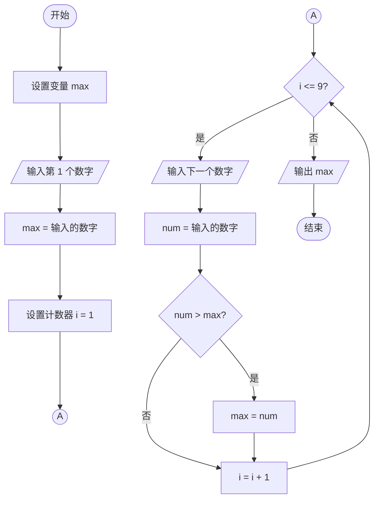
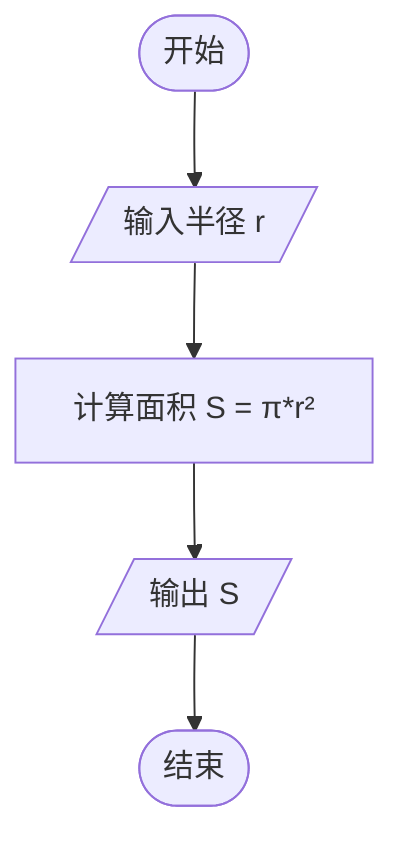
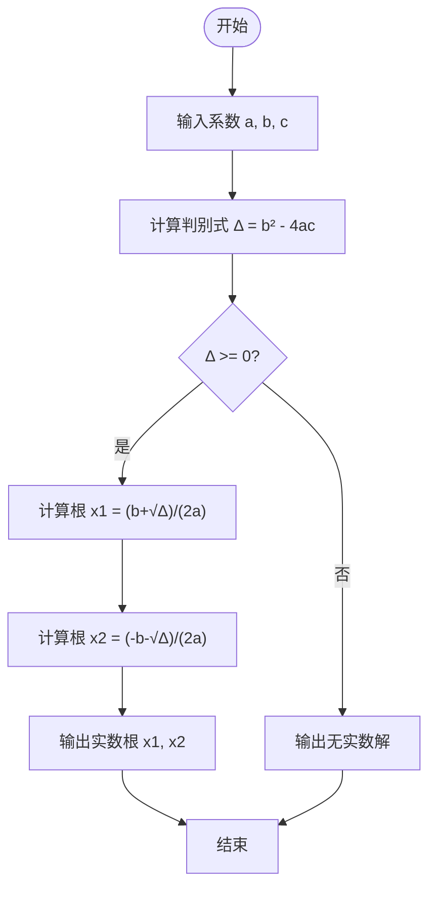
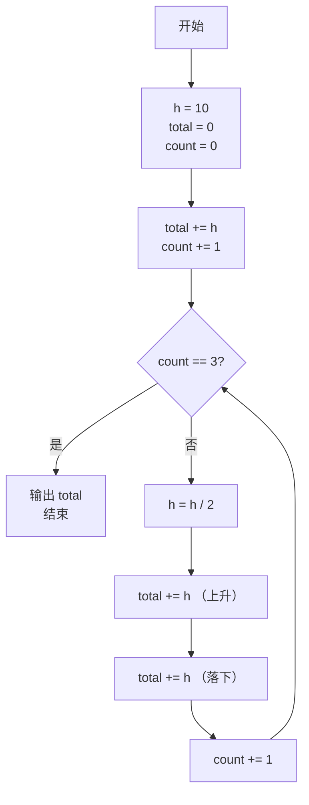

# 算法初探
## 一、算法是什么

**定义**：算法是一组明确定义的指令，用于解决特定问题或完成特定任务。它是计算的核心，通常以有限的步骤将输入转化为输出。算法的三大关键特性是：

- **确定性**：每一步骤明确无歧义。
- **有限性**：算法在有限时间内完成。
- **有效性**：每一步操作简单且可执行。

## 二、伪代码和流程图

伪代码和流程图是两种非常有用的工具，在算法设计和理解中扮演着重要的角色。它们能够帮助程序从**逻辑结构**和**执行过程**两方面更好地理解算法。

### 1. 伪代码

伪代码（Pseudocode）是一种**简化的算法描述**，它通常用来描述计算机算法的**步骤**和**逻辑**，而不需要考虑具体的编程语言的语法。伪代码具有**结构清晰**、**易读性强**的特点，适合用来表达算法的核心思想，帮助程序员理解算法的步骤，而不需要被语言细节所困扰。

计算阶乘的伪代码：

```
Function Factorial(n)
    If n == 0 Then
        Return 1
    Else
        Return n * Factorial(n-1)
    End If
End Function
```

这个伪代码描述了一个递归算法，用来计算一个数的阶乘。它表示：

- 如果 `n` 为 0，返回 1。
- 否则，递归调用 `Factorial(n-1)` 并乘以 `n`。

Python 和伪代码在结构上非常接近，在很大程度上可以替代伪代码。另外，伪代码没有严格的语法要求，本质就是为了表达逻辑，所以可以有自己的习惯，甚至用中文来编写伪代码。以下伪代码设计了一个程序：

输入10个数字，输出这些数字里面的最大值：

```python
开始
设置一个变量 max
提示用户输入第 1 个数字
读取输入的数字，赋值给 max
重复 9 次：
    提示用户输入下一个数字
    读取输入的数字，存入 num
    如果 num 比 max 大：
        把 max 更新为 num
结束循环
输出 max
结束开始
设置一个变量 max
提示用户输入第 1 个数字
读取输入的数字，赋值给 max
重复 9 次：
    提示用户输入下一个数字
    读取输入的数字，存入 num
    如果 num 比 max 大：
        把 max 更新为 num
结束循环
输出 max
结束
```

### 2. 流程图

**流程图**是算法设计中非常常见的工具，它能帮助程序员更直观地理解算法的执行流程。流程图通过图形化的方式展示了算法中的**各个步骤**以及这些步骤之间的**关系**，特别适合用来阐述控制流（如条件判断、循环等）和**数据流动**。

流程图的特点：

1. **直观性**：通过图形化的展示，程序员可以更清晰地看到每一步骤的执行顺序和决策分支。
2. **简化复杂问题**：复杂的算法和逻辑，通过流程图可以分解成简洁、易懂的步骤。
3. **辅助理解**：帮助程序员从另一个角度理解算法，尤其是控制结构，如判断语句和循环结构。

常用的流程图符号：

1. **开始/结束（Start/End）**：通常用椭圆形表示，用来标识算法的开始和结束。
2. **过程（Process）**：用矩形表示，用来表示某个操作或计算过程。
3. **决策（Decision）**：用菱形表示，表示判断或条件判断，用来决定算法流程的走向。
4. **输入/输出（Input/Output）**：用平行四边形表示，表示数据的输入或输出。
5. **连接符（Connector）**：用圆形或小的圆角矩形表示，指代流程图中不同部分的连接，避免过多的线条交叉。

在上文例子中（输入10个数字，输出这些数字里面的最大值），其流程图如下：



## 三、解析算法和模拟算法

### 1. 解析算法

解析算法是指通过**数学公式或逻辑推理直接推导**出问题的解，核心是找到问题的数学规律或逻辑关系，用公式计算答案，通常没有循环结构。

#### 示例1：计算圆的面积

计算圆面积是几何学中最基础的计算之一。

**求解步骤：**

圆面积公式：$A = \pi r^2$
其中：

- $A$ 是圆的面积
- $\pi$ (pi) 是圆周率，约等于 3.14159
- $r$ 是圆的半径

**流程图：**



**伪代码：**

```
开始
  输入半径r
  计算面积S = 3.14159 * r * r 
  输出S
结束
```

**Python 程序实现：**

```python
# 计算圆面积的Python程序
import math  # 导入数学模块，用于获取π值

radius = float(input("请输入圆的半径: "))
area = math.pi * radius ** 2
print(f"圆的半径为 {radius:.2f}，面积为 {area:.2f}")
```

这个程序直接计算了圆的面积，但在编程实践中，我们最好去检查输入的数据，因为用户可能输入负数，汉字或者乱码等，即使是像计算器程序一样只提供按键，用户还可能输入负数或是其他的非法字符，比如0.-2等。

#### 示例2：计算一元二次方程的解

解一元二次方程的标准形式是：$ax^2 + bx + c = 0$，其中，$a$、$b$ 和 $c$ 是已知常数，$x$ 是未知数。

**求解步骤：**

1. **计算判别式**：首先计算判别式 $D = b^2 - 4ac$。
2. **根据 \(D\) 的值确定解的类型**：
   
   如果 \(D > 0\)，计算两个不同的实根。
   
   如果 \(D = 0\)，计算一个实根。
   
   如果 \(D < 0\)，计算复数根（学习`虚数`前，这种情况无解）。

**流程图：**



**Python 程序实现：**

```python
import math  # 引入 math.sqrt() 函数进行开方计算

def solve_quadratic(a, b, c):
    # 计算判别式 D = b² - 4ac
    D = b**2 - 4*a*c
    
    # 判断判别式 D 的值
    if D > 0:
        # 两个不同实数根
        x1 = (-b + math.sqrt(D)) / (2*a)
        x2 = (-b - math.sqrt(D)) / (2*a)
        return f"方程有两个不同的实数根: x1 = {x1}, x2 = {x2}"
    elif D == 0:
        # 一个实数根
        x = -b / (2*a)
        return f"方程有两个相等的实数根: x = {x}"
    else:
		return f"方程没有实数根: x = {x}"

# 示例：解方程 1x² - 3x + 2 = 0
result = solve_quadratic(1, -3, 2)
print(result)
```

假设我们输入方程 $$x2−3x+2=0$$，输出为：

```
方程有两个不同的实数根: x1 = 2.0, x2 = 1.0
```

### 2. 模拟算法

模拟算法通过代码直接模拟问题的过程，按题目描述一步步执行，常用于逻辑简单但步骤繁琐的问题。

#### 示例1：计算小球落地N次后运动的距离

如何计算一个小球从 10 米高处自由落下，每次落地后反弹到原高度的一半，第 3 次落地时总共经过的距离？

| 次数  | 下落高度 | 上升高度 | 总距离（本次） | 累计距离      |
| ----- | -------- | -------- | -------------- | ------------- |
| 第1次 | 10m      | 5m       | 10（落）       | 10            |
| 第2次 | 5m       | 2.5m     | 5+5=10         | 10+5+5=20     |
| 第3次 | 2.5m     | 1.25m    | 2.5+2.5=5      | 20+2.5+2.5=25 |

所以：第3次落地后，总共走了 10 + 5 + 5 + 2.5 + 2.5 = 25 米

**求解步骤：**
1. 设置初始高度 `h = 10`
2. 初始化累计距离 `total = 0`
3. 用循环模拟每次落地和反弹（除了第一次没有反弹上升）
4. 统计落地和反弹过程的路径长度
5. 重复上述步骤直到达到第3次落地


**流程图：**



**Python 程序实现：**

```python
def calculate_total_distance(h, drops):
    total_distance = 0  # 初始化总距离
    for i in range(drops):
        # 第一次下落直接加上初始高度
        if i == 0:
            total_distance += h
        else:
            # 后续每次上升和下落
            total_distance += 2 * h
        # 反弹高度减半
        h /= 2
    return total_distance

# 初始高度
initial_height = 10
# 第3次落地
drops = 3

# 计算总距离
total = calculate_total_distance(initial_height, drops)
print(f"第{drops}次落地时，总共经过的距离是：{total} 米")
```


## 四、练习
### 1. 计算三角形的面积

**描述**: 给定三角形的三条边长 $a$、$b$ 和 $c$，请使用海伦公式计算三角形的面积。


 海伦公式为：

- 半周长 $s$：

$$
s = \frac{a + b + c}{2}
$$

- 三角形面积 $A$：
$$
A = \sqrt{s(s - a)(s - b)(s - c)}
$$

其中，$s$ 为半周长，$a$、$b$ 和 $c$ 为三角形的三条边。

### 2. 计算圆角矩形的面积

**描述**: 给定一个矩形的长 $l$、宽 $w$ 和圆角的半径 $r$，请计算圆角矩形的面积。圆角是指每个角都是一个四分之一圆的矩形

圆角矩形的面积公式为：
$$
S=l*w−4*r^2+πr^2
$$

其中，$l$ 和 $w$ 是矩形的长和宽，$r$ 是圆角的半径。

### 3. 模拟停车场系统

**题目**: 设计一个简单的停车场系统。假设停车场有多个停车位，每个停车位可以停放一辆车。每辆车可以有不同的类型（如普通车、SUV）。编写程序模拟车的入场、出场和查询停车状态。

**要求**:

- 提供 `Park()` 类，包含停车位信息。
- 提供方法：`park_car()`、`remove_car()`、`get_parking_status()`。

### 4. 模拟银行账户

**题目**: 设计一个银行账户类 `BankAccount`，其中包括存款、取款、查看余额等基本操作。

**要求**:

- 创建 `BankAccount` 类，包含账户余额、账户号、账户持有人的属性。
- 提供 `deposit()`、`withdraw()` 和 `check_balance()` 方法。
