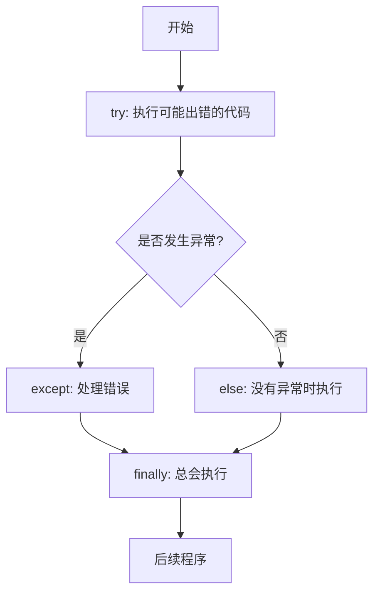

# 捕获异常
## 一、Try Except 概述

在程序运行过程中，可能会遇到各种错误（异常）。为了避免程序因为错误而崩溃，可以使用 try except 来捕获异常并处理这些错误，比如在一段涉及到计算除法的程序中：

```python
num = int(input("请输入一个数字: "))
result = 10 / num
```

如果输出的不是整数，比如输入`1.2`，那么`int()`函数将会抛出异常，导致程序无法进行：

```md
请输入一个数字: 1.2
Traceback (most recent call last):
  File "c:\Users\弦子\Desktop\csv读取\test.py", line 1, in <module>
    num = int(input("请输入一个数字: "))
          ^^^^^^^^^^^^^^^^^^^^^^^
ValueError: invalid literal for int() with base 10: '1.2'
```

如果输入`num`为`0`,由于`0`不能作为除数，程序第二行运行时，python 这会抛出异常：ZeroDivisionError

遇到可能出错的情况，我们用 try 来尝试执行，用 except 来处理异常，这样程序可以继续运行：

```python
try:
    # 尝试执行的代码（可能出错）
    num = int(input("请输入一个数字: "))
    result = 10 / num
except ValueError:
    # 捕获输入不是数字的错误
    print("错误：请输入一个有效的数字！")
except ZeroDivisionError:
    # 捕获除以零的错误
    print("错误：不能除以0！")
else:
    # 如果没有任何异常，执行这里
    print(f"计算成功，10 除以 {num} 的结果是 {result}")
finally:
    # 无论是否出错，都会执行这里
    print("程序结束，无论是否发生异常，这句话都会打印。")
```

**try 块**：让你测试一段可能出错的代码。

**except 块**：让你处理发生的错误，一段代码可能出现多种错误，可以使用**多个** `except` 分别处理

**else 块**：当没有错误发生时，执行这部分代码。

**finally 块**：无论 try 和 except 的结果如何，都会执行这部分代码。

---

流程图：




## 二、基本语法

```python
try:
    # 可能会出错的代码
except 错误类型:
    # 出现该错误时执行的代码
```

你可以根据需要添加多个 `except`，甚至加上 `finally`：

```python
try:
    num = int(input("请输入一个数字:"))
    print(10 / num)
except ValueError:
    print("输入的不是数字")
except ZeroDivisionError:
    print("不能除以 0")
```

在 Python 中，`except` 后面**可以不写错误类型**，例如：

```python
try:
    x = 10 / 0
except:
    print("发生错误")
```

这种写法可以捕获所有错误，但不推荐滥用，因为会把所有问题都隐藏起来，不利于调试。

更推荐的写法是：

```python
except Exception as e:
    print("发生错误:", e)
```

或者捕获特定错误：

```python
except ValueError:
    print("输入错误")
```

---

> [!tip]
>
> `try`不能单独存在，至少需要一个`except`或者`finally`。

## 三、常见的写法

### 1. 捕获特定错误

```python
try:
    open("test.txt", "r")
except FileNotFoundError:
    print("文件不存在")
```

### 2. 捕获所有错误（不推荐滥用）

```python
try:
    x = 10 / 0
except Exception as e:
    print("发生错误:", e)
```

### 3. 使用 finally

`finally`块无论是否报错都会执行，它常用来释放资源，比如关闭文件等，这样可以保证`try`里面打开的文件，无论是否中途`return`，出错能被正确的关闭文件。

```python
try:
    f = open("data.txt", "r")
except FileNotFoundError:
    print("文件未找到")
finally:
    print("结束操作")
```

## 四、常见异常类型表

| 异常名称          | 触发场景                         |
| ----------------- | -------------------------------- |
| ValueError        | 类型转换失败，如 `int("abc")`    |
| TypeError         | 类型不匹配，如列表加整数         |
| IndexError        | 下标越界，如访问不存在的列表元素 |
| KeyError          | 字典中找不到对应 key             |
| ZeroDivisionError | 除数为 0                         |
| FileNotFoundError | 打开的文件不存在                 |
| NameError         | 使用了未定义的变量               |
| ImportError       | 导入模块失败                     |
| RuntimeError      | 运行时发生的常规错误             |
| Exception         | 所有异常的基类                   |
