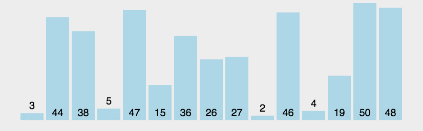
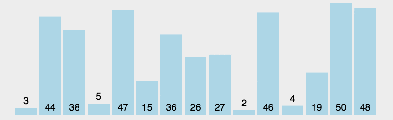
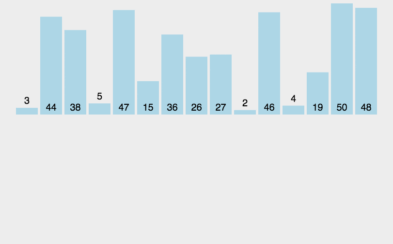

# 排序算法

**排序算法**，就是把一组数据按照一定的规则重新排列的算法。最常见的规则有两种：

- **从小到大排序**
- **从大到小排序**

## 一、冒泡排序（Bubble Sort）

### 1. 基本思想

冒泡排序是一种通过相邻元素之间的比较和交换，逐步将“最大”元素“冒泡”到数组末端的排序算法。这个过程类似于水中的气泡上升，因此得名“冒泡排序”。

### 2. 工作原理

- 从数组的开始，依次比较相邻的元素，如果前一个元素大于后一个元素，则交换它们的位置。
- 每一次遍历，都会将当前未排序部分中的最大元素移动到数组的末端。
- 这个过程重复进行，直到所有元素都被排好序。



### 3. 程序实现

```python
# 原始列表
arr = [5, 3, 4, 1, 2]
n = len(arr)
# 外层循环：控制比较的轮数
for i in range(n - 1):
    swapped = False  # 标记这一轮是否发生交换
    # 内层循环：相邻元素比较
    for j in range(0, n - i - 1):
        if arr[j] > arr[j + 1]:
            # 交换位置
            arr[j], arr[j + 1] = arr[j + 1], arr[j]
            swapped = True
    # 如果这一轮没有发生交换，说明已经有序
    if not swapped:
        break
# 打印列表
print(arr)
```

## 二、选择排序（Selection Sort）

### 1. 基本思想

选择排序是一种通过**不断从未排序部分中选择最小（或最大）元素**，并将其放到已排序部分末尾的排序算法。

### 2. 工作原理

- 将数组分为**已排序部分**和**未排序部分**。
- 每一轮从未排序部分中找出最小的元素。
- 将该最小元素与未排序部分的第一个元素交换位置。
- 重复上述过程，直到所有元素都有序。

 

### 3. 程序实现

```python
# 原始列表
arr = [5, 3, 4, 1, 2]
n = len(arr)

# 外层循环：控制选择的轮数
for i in range(n - 1):
    min_index = i  # 假设当前位置是最小值的位置

    # 内层循环：在未排序部分中寻找最小值
    for j in range(i + 1, n):
        if arr[j] < arr[min_index]:
            min_index = j

    # 将最小值放到当前位置
    arr[i], arr[min_index] = arr[min_index], arr[i]

# 打印列表
print(arr)
```

## 三、插入排序（Insertion Sort）

### 1. 基本思想

插入排序是一种类似于**整理扑克牌**的排序算法。

它的思想是：
将当前元素插入到前面已经排好序的序列中，使前面的序列始终保持有序。

### 2. 工作原理

- 将第一个元素看作已经排好序。
- 从第二个元素开始，依次取出当前元素。
- 将当前元素与已排序部分的元素从后向前比较。
- 找到合适的位置后，将当前元素插入。
- 重复上述过程，直到整个序列有序。



### 3. 程序实现

```python
# 原始列表
arr = [5, 3, 4, 1, 2]
n = len(arr)

# 外层循环：从第二个元素开始
for i in range(1, n):
    current = arr[i]  # 当前要插入的元素
    j = i - 1

    # 将比 current 大的元素向后移动
    while j >= 0 and arr[j] > current:
        arr[j + 1] = arr[j]
        j -= 1

    # 插入到合适的位置
    arr[j + 1] = current

# 打印列表
print(arr)
```


