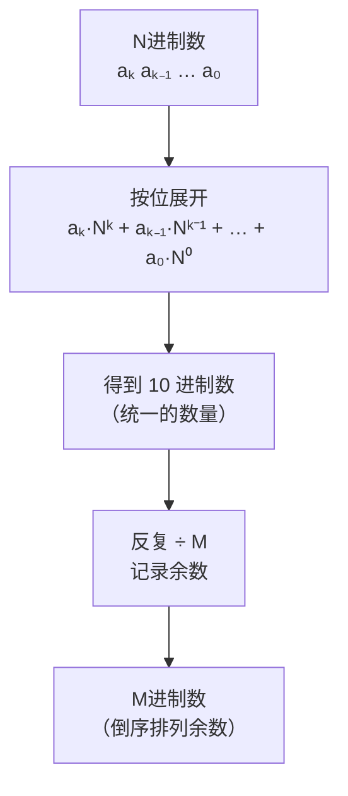

#  进制与转换

## 一、数字系统的发展历程

### 1. 远古时代：非位置计数系统

- 人类最初记数是用 **结绳记事**、**刻痕**、**石子**。
- 后来发展出一些符号，比如罗马数字：
  - Ⅰ = 1, Ⅴ = 5, Ⅹ = 10，L = 50，C = 100，D = 500，M = 1000 
  - **特点：**
    - 符号有限
    - **数值靠符号相加/相减表示**，小在大前则相减，大在小则相加。
    - 同以符号不能出现超过3次， 所以数字四不能写成 IIII 必须写成 IV（5-1）
    - 用“加横线”规则：一条横线 = 乘 1000。
- **缺点**：
  - 表示大数很麻烦（例如 2024 写成 MMXXIV）。
  - 没有统一的“位权”概念。

### 2. 位置计数系统的出现

早在 **公元 3 世纪左右**，印度学者就已经发明了 **十个数字符号（0–9）**，以及最重要的概念：**“0”** 和 **位值制（位置计数系统）**

- 关键发明是 **“零”** 的引入。
- 印度—阿拉伯数字体系：0–9 十个数字，靠位置决定大小。
- 特点：
  - 同一个符号“2”，在不同位置代表不同数值。
  - 例如：234 = 2×100 + 3×10 + 4×1。
- 优点：
  - 大数、小数都可以清晰表示。
  - 运算规则统一，便于计算。
- 这就是我们日常使用的 **十进制**。

## 二、常见的进制系统

1. **十进制（Decimal，基数 10）**
   - 数字范围：0–9
   - 每一位的权重：10ⁿ
   - 举例：347 = 3×10² + 4×10¹ + 7×10⁰
2. **二进制（Binary，基数 2）**
   - 数字范围：0, 1
   - 权重：2ⁿ
   - 计算机的底层语言（电路只有通电/断电）。
   - 举例：1011₂ = 1×2³ + 0×2² + 1×2¹ + 1×2⁰ = 11
3. **八进制（Octal，基数 8）**
   - 数字范围：0–7
   - 权重：8ⁿ
   - 计算机早期常用来简化二进制（3 位二进制可对应 1 位八进制）。
4. **十六进制（Hexadecimal，基数 16）**
   - 数字范围：0–9 + A–F (表示 10–15)
   - 权重：16ⁿ
   - 程序设计、内存地址常用，方便人类阅读二进制（4 位二进制对应 1 位十六进制）。
   - 例：0x1F = 1×16¹ + 15 = 31

## 三、进制的转换方法

### 1. N进制 → 十进制

N进制转十进制的方法为：**按权展开**

> [!note] 
>
> 按权展开:每一位数字 × 基数^位置指数，然后相加。

- **二进制转十进制**
  - 例：`1011₂`
  - = 1×2³ + 0×2² + 1×2¹ + 1×2⁰
  - = 8 + 0 + 2 + 1 = **11**
- **八进制转十进制**
  - 例：`157₈`
  - = 1×8² + 5×8¹ + 7×8⁰
  - = 64 + 40 + 7 = **111**
- **十六进制转十进制**
  - 例：`2F₁₆` （F=15）
  - = 2×16¹ + 15×16⁰
  - = 32 + 15 = **47**

### 2. 十进制 → N进制

十进制转N进制的方法为：**短除法取余（整数部分）**

> [!note]
>
> 短除法取余:不断除以目标进制，记录余数，**倒序**排列。

**例1：十进制 → 二进制**

- 把 23 转二进制
  
  ```markdown
  23 ÷ 2 = 11 余 1
  11 ÷ 2 = 5 余 1
  5 ÷ 2 = 2 余 1
  2 ÷ 2 = 1 余 0
  1 ÷ 2 = 0 余 1
  ```
- 倒序写余数 → **10111₂**

**例2：十进制 → 八进制**

- 把 79 转八进制
  ```markdown
  79 ÷ 8 = 9 余 7
  9 ÷ 8 = 1 余 1
  1 ÷ 8 = 0 余 1
  ```
- 倒序 → **117₈**

**例3：十进制 → 十六进制**

- 把 254 转十六进制
    ```markdown
     254 ÷ 16 = 15 余 14 (E)
     15 ÷ 16 = 0 余 15 (F)
    ```
- 倒序 → **FE₁₆**

### 3. N 进制到 M 进制

一般地，N进制到M进制需要借助十进制作为中间过度，也就是首先把N进制的数用十进制表示，再转成Ｍ进制：




## 四、Python 常用进制函数

| 函数           | 功能                        | 示例                                      |
| -------------- | --------------------------- | ----------------------------------------- |
| `bin(x)`       | 将整数 x 转为二进制字符串   | `bin(10)` → `'0b1010'`                    |
| `oct(x)`       | 将整数 x 转为八进制字符串   | `oct(15)` → `'0o17'`                      |
| `hex(x)`       | 将整数 x 转为十六进制字符串 | `hex(31)` → `'0x1f'`                      |
| `int(x, base)` | 将字符串 x 按 base 转为整数 | `int('1010',2)` → 10；`int('1f',16)` → 31 |

> [!tip]
>
> `int(x,base)`函数的字符串`x`可以是带进制前缀(‘0b’,‘0o’,‘0x’)的字符串，但是要注意必须和`base`一致，否则无法进行转换。因为对于Python的`int()`函数，是按参数`base`来转换的，但是如果`base`为`2`，但用了 `0o` 前缀，这里会出现矛盾，导致函数无法正常转换。

使用示例：

```py
# 表示法
a = 0b1010  # 二进制 10
b = 0o17    # 八进制 15
c = 123     # 十进制 123
d = 0x1F    # 十六进制 31

# 函数转换
print(bin(10))   # '0b1010'
print(oct(15))   # '0o17'
print(hex(31))   # '0x1f'

# 字符串转整数
print(int('1010', 2))  # 10
print(int('17', 8))    # 15
print(int('1f', 16))   # 31
```

## 五、习题

1. 写出以下数字的 10 进制数

```python
# 二进制
a = 0b1011
b = 0b11010
c = 0b111111

# 八进制
d = 0o17
e = 0o25
f = 0o77

# 十六进制
g = 0x1F
h = 0x2A
i = 0xFF
```

2. 将十进制数字 45 转换为二进制、八进制、十六进制。

3. 程序设计：写一个 Python 函数 `convert(num_str, base_from, base_to)`，可以将任意进制字符串 `num_str` 从 `base_from` 转为 `base_to`，返回十六进制或八进制等字符串。


